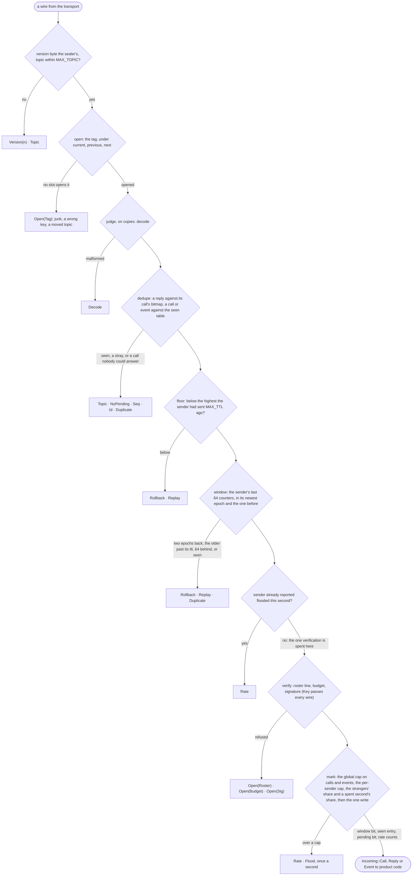
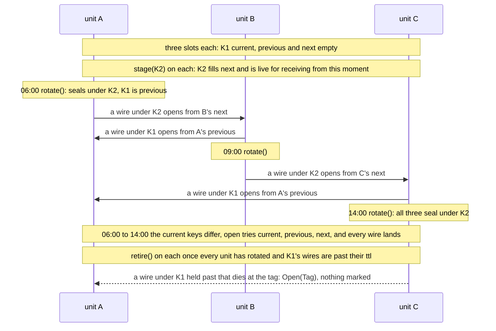

# mudRPC — Specification

**RPC over unstable networks, from any language.**

Each layer described once, as it is. Rules are in CLAUDE.md; this file is what we build and why. Tests listed here are the floor for the work that builds the layer; each feature designs its own on top.

## What we build

1. **Core (Rust, `#![no_std]`, no allocation, no crates).** A pure state machine: bytes and ticks in, bytes and events out. It owns no transport, no clock, no socket. Four modules, auditable in a day; the signed and AES sealers sit beside it in `auth/` and `gcm/`, behind its one seam.
2. **Adapters.** The transport contract, and two adapters we own: `sim` and `lan`. Real transports are written by the people who know them, against the contract, the mock of their transport in `sim`, and a conformance suite.
3. **Developer product.** One C ABI with every language wrapper sitting on it as a single vendored file; `mud gen`, which parses `.proto` and emits thin stubs; a skill per wrapper and adapter; the simulator.

The layer picture and how the host pumps bytes between them are in [README.md](README.md).

## Delivery semantics

The three questions a drone team asks first. The answers are the whole contract.

**What happens to a message that cannot be delivered now?** It waits, up to its ttl. Where it waits is the transport's business: at the sender when there is no path (Reticulum), in custody at the last peer that had it (DTN), or in core's outbox until the host drains it. When a path appears, it goes. Core retries nothing, because nothing was lost; it was waiting.

**How old can a delivered message be?** At most `ttl_secs`. The sender says how long the message is worth acting on; the mesh drops it after that; the receiver never sees anything older. The receiver cannot measure age itself, since no clock is on the wire, so the promise rests on the transport honouring lifetime, which is a conformance test. Freshness inside the window is the product's: a method that needs a timestamp puts one in its payload.

**Queue or real time?** One knob: ttl. Real time is a short ttl: a steering command with ttl 2 expires fast and the product falls back. A queue is a long ttl: a mission upload with ttl 3600 arrives whenever the link heals. Telemetry is a short ttl on a topic: fifty stale positions die in the mesh instead of arriving after heal. There is no second mechanism.

**What the caller sees.** `call` returns at once with an id. Later comes a `Reply`, or `Expired` at ttl. Never a hang, never a network error: off-mesh is the normal state. A reply is given the call's ttl, measured from the reply, so a reply to a caller that went off-mesh waits in the mesh like any other message; a reply that arrives after the caller gave up is `NoPending`.

**What the mesh may do.** Deliver late, deliver twice, deliver out of order, deliver to several listeners, or never deliver. Core hides exactly two of these: twice (the per-sender window and the seen table) and never (`Expired`). Order and fan-out are facts of life the stubs make visible with `seq` and `end`.

Open: supersession, where a newer event from the same sender makes older ones worthless. ttl covers most of it; a `supersedes` flag is asked only if a real product shows the one knob is not enough.

Tests:
- The partition-heal scenario: a message queued within ttl arrives, one past ttl never arrives, the caller sees `Expired` exactly once, a duplicate executes once, and nothing is asserted about order. [`partition_heal_expires_one_call_and_lands_the_rest_after_heal`, `expired_call_reports_once_and_late_reply_is_dropped`, `redelivered_call_executes_once`]
- Core drops outbox items past ttl when `outgoing` reaches them. [`expired_outgoing_dies_at_the_exit`]

## The messaging protocol

mudRPC is gRPC's service model carried as self-contained message packets. Every gRPC concept lands on a message or is cut on purpose.

| gRPC | mudRPC |
| --- | --- |
| service | a topic, named by the fully qualified service name |
| method | `method` in a call message |
| unary call | one call, one reply |
| server streaming | one call; replies share its id, each with `seq`, last with `end` |
| client streaming | cut: no API produced a client-stream item; a call with `seq` other than 0 is `Dropped::Seq` |
| bidirectional | both; each direction independent |
| deadline | `ttl_secs`, in the message and handed to the transport |
| status | every reply carries gRPC's status number and optional detail; OK costs zero bytes |
| metadata | cut |
| cancellation | ttl expiry; no cancel message |
| wire format | protobuf, unchanged; interoperates with protoc output |

**Streams are packets.** A stream is a sequence of self-contained messages sharing an id, each with `seq`, arriving out of order, with gaps, hours apart. The receiver sees the gaps. No byte pipe, no retransmit, no ordering. A `.proto` with `stream` maps onto it unchanged.

**Events.** A method with the `topic` option is a publish: one message, no reply, to a topic. One topic carries one message type.

**Video.** Live video needs a byte pipe and bandwidth the mesh does not have, and nobody re-invents their camera adapter. The camera's own link (RTSP, WebRTC, MAVLink camera protocol) keeps carrying live video. mudRPC carries camera control as calls, "stream available at X" as events, and the degraded fallback as a stream of self-contained keyframes or stills when the live link drops. Each item is a complete picture, so a gap loses a frame, not the feed. A stream is leased by the call that opened it and ends with that call's ttl: when nobody renews, the server stops, and no bytes flow to a receiver that is gone.

**gRPC's production failures, and where they went.** Each is a live-connection assumption; mudRPC has none.

| gRPC in production | mudRPC |
| --- | --- |
| HTTP/2 pins a client to one backend; hot spots; needs an L7 proxy | No connections. A topic is the address, any listener may answer, first reply wins. |
| Zombie connections: a silent black hole stalls clients for minutes; needs keepalive tuning | No socket state to trust. Off-mesh is normal; the only failure signal is `Expired` at the caller's ttl. |
| Shared `.proto` couples teams; proto3 dropped `required` | Unknown fields skipped, so releases evolve independently. Field presence is the product's check, as in gRPC. |
| Browsers cannot speak HTTP/2 frames; gRPC-web needs a proxy | The wasm build exports the same ABI. No HTTP anywhere. |
| Stream limits per connection; hidden client queues; channel pools | Limits are explicit: `PENDING`, `SEEN`, `OUT` are capacities and `Full` is a return code. |

**The firewall property.** The only path from the mesh into product code is: unseal, decode the envelope, decode the payload against the `.proto`. Anything that fails any step is dropped before product code runs. No heap, fixed buffers, no std: the attack surface is one fuzzed decoder.

## Human problems

We solve human problems. If a feature doesn't move one of these lines, it's cut.

| Who | Problem today | What changes |
| --- | --- | --- |
| Drone crews and field teams | Links drop, apps freeze, state is lost; decisions go over chat apps | Apps keep working off-mesh and catch up when the link heals |
| Operations | Every vendor is a separate integration; the picture is only as good as the worst link | One contract for all feeds; degraded links degrade gracefully, not to zero |
| Developers | Integrating with Reticulum or DTN directly is intensive and buggy; no stubs, no docs, no test harness | `.proto` in, native stubs out; unit-test against a simulated mesh with no radio |
| Hardware makers | 500 new models a year, each wired in by hand | Ship one adapter, work with every backend |
| Reticulum / DTN maintainers | Every integrator asks the same questions; bugs blamed on the stack | One adapter per stack, maintained once; their internals stay theirs |

**What the field says** (2026, sources in Prior art). ROS 2 over DDS was built for wired, static networks: on Wi-Fi its multicast discovery storms, its reliability timers retransmit into the contention, and large payloads fragment and stall; the community chose Zenoh to replace it, a few bytes of per-message overhead against DDS's 56. MAVLink's plain messages carry no acknowledgement, its command protocol retries blindly, its mission protocol re-requests what was lost, and the friction is over who owns the timeout. MIT's LCM chose brokerless UDP multicast with a schema compiled into every language and no RPC, and is maintained for that simplicity. Payload integration is where the money leaks: a closed payload SDK ties a camera to one airframe, and the 2026 answer is open contracts and the Pixhawk Payload Bus; integration with a large operator's system is a standards exercise by insiders, the bridge-adapter model. Each is an argument the design makes: no discovery protocol, no live session, no retry storm, one knob for lifetime, a schema in every language, an open contract any vendor can pass.

## The layers

### 0 · The mesh as it is

| Fact | What it removes |
| --- | --- |
| Delivery may take hours or never happen | Anything that blocks. Anything with a socket lifetime. |
| Reticulum delivers with no source address | "Reply to sender." The caller names its inbox. |
| Clocks are not synchronised | Absolute time on the wire. `now` is the caller's uptime. |
| A topic may have many listeners | "Exactly one reply." |
| The smallest peer has no heap | Dynamic tables. Strings. Everything is fixed-capacity or caller-owned. |
| The transport is someone else's code | Any requirement that the transport call into us. The host pumps. |

### 1 · The wire

```
nonce     = sender(4) ‖ epoch(4) ‖ counter(4)                                  both ends compute it the same way
header    = nonce XOR mask    Key: ChaCha20_block(key, counter 2³²−1, sample)[0..12], sample = the 12 bytes after the header
                              Gcm: AES-ECB(header key, sample)[0..12], sample = the 16 bytes after the header
wire      = version(1) ‖ header(12) ‖ AEAD(key, nonce, ad = version ‖ topic, Envelope ‖ trailer) ‖ tag(16)
signature = Ed25519(seed_of_sender, nonce ‖ version ‖ len(topic) ‖ topic ‖ envelope)      the trailer under Signed, 64 bytes
id        = the nonce of the call (absent on a unary call: it is the header)
version   = 1 Key (ChaCha20-Poly1305) · 2 Signed<Key> · 3 Gcm (AES-256-GCM) · 4 Signed<Gcm>
```

```proto
message Envelope {                 // a comment in envelope.rs, not a shipped .proto
  bytes  id       = 1;             // the call's 12-byte nonce, absent on a unary call
  uint32 ttl_secs = 2;             // lifetime handed to the transport; dedupe window
  uint32 seq      = 3;             // streams; absent means 0
  bool   end      = 4;             // last item of a stream
  oneof body { Call call = 5; Reply reply = 6; Event event = 7; }
}
message Call  { string method = 1; string reply_to = 2; bytes payload = 3; }
message Reply { uint32 status = 1; string detail   = 2; bytes payload = 3; }
message Event { bytes payload = 1; }
```

The envelope and the sealed wire, in `core/envelope.rs`, `core/codec.rs` and `core/rpc.rs`:
- **One plaintext byte: the version, and one live version.** A receiver implements exactly one version, its sealer's; there is no second parser, so no second attack surface. Any other version is rejected before the key is touched and counted as `Dropped::Version(n)`, which is how an operator learns the fleet is mixed. It is the one thing a wire says of itself in clear, a suite statement telling a listener the fleet's cipher and whether it signs, not a negotiation, which would need a live exchange. Within a version, new optional fields are compatible through unknown-field skipping. A bump of the envelope's version is reserved for an incompatible change and happens only at a release boundary (a sealer names its own, below); migration is a flag day per unit, the same event as a key rotation. Third-party services attach through a bridge pinned to the fleet's version.
- **Sealed whole.** Nothing else on the wire is readable without the key, not `method`, not `reply_to`. Version and topic are the associated data, so a message cannot be replayed onto another topic. No canonical re-encoding is needed to verify.
- **Protobuf-encoded with our own codec.** Absent fields cost nothing; unknown fields are skipped, so a later release can add a field without breaking earlier peers in the field.
- **Three layers of encryption, each symmetrical on its own two ends, none depending on another.** Beneath us, the transport's: Reticulum seals end to end, radios encrypt their links. Ours: the sealed envelope and the masked header, one fleet key, replaceable through `Sealer`. Above us, the product's: the payload is opaque bytes, so a product that wants its own cipher, its own keys or a signature puts them inside the payload on both sides and we never know. We document all three and promise only ours.

The cipher, in `core/seal.rs` and `gcm/aes.rs`, `gcm/ghash.rs`, `gcm/lib.rs`:
- **ChaCha20-Poly1305**, RFC 8439, written from the RFC in `seal.rs`, its test vectors the first tests. Tag compare is XOR-accumulate over 16 bytes with no early return, read in review and measured by the constant-time gate.
- **AES-256-GCM behind the same seam.** `Gcm` is AES-256-GCM from FIPS 197 and SP 800-38D, in its own crate `gcm/` so core stays four modules, a `Cipher` under core's `Slots` as ChaCha20-Poly1305 is (`Gcm` is `Slots<Aes256Gcm>`, `Key` `Slots<ChaCha20Poly1305>`, so the three slots, the rotation and the zeroing are written once), a `Sealer` with version 3 and no trailer: the same 12-byte nonce and 16-byte tag, so the wire's shape is the one the peer already handles. AES is bitsliced and has no table: the S-box is the Boyar–Peralta circuit over eight bit-planes, several blocks per word, so no memory access depends on a key or a byte, and the key schedule runs through the same circuit; CTR gives the keystream with the 32-bit block counter SP 800-38D assigns a 12-byte IV, from 2; GHASH over GF(2¹²⁸) is a bit-serial multiply under masks, no table; the tag is GHASH over `ad ‖ ciphertext ‖ lengths` under E(K, J₀), compared by a fold as Poly1305's is. The price of no table, measured on the Cortex-M4 by `qemu/count.rs`: a signed call's 113-byte wire costs 13 times ChaCha20-Poly1305's to seal or open (128 480 instructions against 9 800 to seal, 128 560 against 9 920 to open), and GHASH 23 times Poly1305 over the same 113 bytes (79 720 against 3 520). A Rust product selects it by type; the ABI by `mud_config.cipher` (layer 5).
- **The key.** One 32-byte fleet key, pre-shared out of band, as Meshtastic and MeshCore channels are in the field. It is 32 bytes from a cryptographic random source, never a passphrase or anything derived from one: there is no handshake, but every wire is an offline key check, as under any AEAD, since a candidate key opens it or does not, so a key drawn from a dictionary falls to that dictionary. The nonce is public by design; ChaCha20 takes key and nonce as separate inputs, so a listener with every packet learns nothing of the key, where WEP's RC4 leaked it through the IV.

The nonce. A sender has a name and a number. The name is its inbox topic, and a topic is UTF-8 of 1 to `MAX_TOPIC` (64) bytes, never empty, since a peer named nothing would listen on nothing: `new`, `listen`, `call`, `publish` and `reply` refuse an empty one as `Empty` (`MUD_EINVAL` at the ABI), a wire on one is `Dropped::Topic` before the tag, as one over 64 is, and a call whose `reply_to` is either is `Dropped::Topic` after it, in `judge` before `verify`, since nobody could answer it. The number makes every nonce unique without randomness, gives a receiver a per-sender replay floor and a cost bound, and is what a signature attaches to. It lives in `core/rpc.rs`.
- **Sender.** A 32-bit roster number assigned at provisioning beside the key. Zero is "unprovisioned": a peer built with it exists but every send returns `Unprovisioned`, so a device image ships with sender 0 and provisioning writes the real number into a per-device slot. Two devices under one number share nonces, which is the one error the roster must prevent; one `Peer` per roster line is the rule for hosts running several.
- **Epoch, written ahead.** A 32-bit counter the host persists beside the key, as key material, and commits to storage before `new` or `resume` returns a peer that can send. `new(name, sealer, sender, epoch)` takes the host's epoch, there being no block yet; `resume(epoch)` and `renew(epoch)` refuse one at or below the block's, and `renew` clears `Exhausted`. Core never changes the epoch itself; `rotate` leaves it alone, because reuse across different keys is harmless and a core-side bump would diverge from the host's record. There is no random epoch: a device that persists the key can persist four more bytes, and a device that cannot persist anything cannot be rotated either. Where a GPS or RTC exists, `epoch = max(stored + 1, coarse boot time)` survives a storage rollback.
- **Counter.** Climbs by one per message. At 2³² the peer returns `Exhausted` until `renew`; at `MAX_PER_SEC` that is two years of continuous sending.
- **Restore, clone, reflash are provisioning events.** The host's storage is the monotonic authority; a backup restored, an image cloned or a device reflashed has rolled that authority back, and core cannot know. Such a device gets a new sender number (or a new key) before it speaks; the receiver-side window and floor below are the field detector for the case where it did not, and name a device one epoch behind its original within its wire's ttl of a receiver first hearing the original's epoch, or at its first answer to a call made since, not a week later.
- **Save disarms the copy.** The block is its own save file, so a host could copy it back and send without `resume`, under the old epoch and counter: keystream reuse, the one failure the design exists to prevent. The block carries an arm byte that `new` and `resume` set, `resume` only once it has taken the epoch; the ABI's `mud_save` is the one way to copy a block out and clears it in the copy, every wrapper's `save` goes through it, and `send` refuses an unarmed block as `Corrupt`; delivery still works, since receiving reuses nothing. A copy taken any other way is the host's own epoch problem; the documented path fails closed by construction.
- **Core has no randomness at all.** Time and the epoch are inputs. Determinism is a property to state, not to fear: unpredictable ids were never load-bearing, because without the key no one forges a tag and with it one forges anything. The one thing predictability changes is the poisoned-reply race under threats: a key holder can forge replies to calls not yet made. Accepted; `Signed` names the forger, and a product that cannot tolerate the race checks the sender on the reply.
- **The id field.** Absent on a unary call, where it equals the header; present on replies. A call carries `seq` 0 or is `Dropped::Seq`; an id field present and unequal to the header is `Dropped::Id`, whatever the `seq`. The reason is the server: it answers with the id it was given, and under a signed fleet that answer carries the server's own signature, so a roster member who could plant another caller's pending nonce on a call would have an honest unit sign the reply to a call it never received.
- **Dedupe keys on the nonce.** The seen table holds `(nonce, expires_at)`, one table for calls and events; since the window below is the memory for a known sender, the table is the backstop for a sender the sender table holds no window for. Replies match a pending call by id and dedupe on the per-seq bitmap.

The header mask, in `core/seal.rs` and `gcm/lib.rs`:
- **The header is masked, per wire.** Reticulum removed source addresses on purpose; a plaintext sender number would put one back one level up, and a passive listener with no key would learn every emitter's roster number, rate and reboot count. The 12-byte header is XORed with a mask derived, as QUIC protects its headers, from the key and a sample of the wire itself, which the receiver has before it needs the mask. A listener learns sizes and timing and nothing of the nonce. Under `Key` the sample is the twelve bytes after the header and the mask a block of the fleet key under ChaCha20 counter 2³² − 1, one the AEAD never reaches, sound while ChaCha20 is a pseudorandom function; QUIC derives a separate header key, and so would this if that assumption ever thinned. Under `Gcm` it is AES-ECB of the sixteen bytes after the header, as QUIC protects its headers under AES, under a header key derived as QUIC derives its own: the two blocks `ff…ff ‖ 0` and `fe ff…ff ‖ 0` under the slot's key, which GCM never encrypts (its blocks are 0 for H and IV ‖ counter from 1), so no mask and no checksum is one of GCM's blocks. Two wires with an equal sample share a mask and their headers XOR to their nonces' XOR, at 2⁻⁹⁶ a pair under `Key`, a birthday at 2⁴⁸ wires that a fleet of a thousand at the cap reaches in 139 years, and 2⁻¹²⁸ under `Gcm`; QUIC carries the same property.

The per-sender window and floor, rate, the counters, in `core/rpc.rs`:
- **Per-sender window.** The counter climbs by one per message within an epoch, so a receiver remembers, per sender, the highest counter seen and a 64-bit map of which of the `WINDOW` (64) below it have arrived, for the sender's newest epoch and the one before (the mesh may still carry wires a device sent before its reboot). In a window a wire is `Duplicate` if its bit is set and accepted if not, in any order; 64 or more below the highest seen (the map covers the highest and the 63 below it) it is `Dropped::Replay`; from an epoch older than the two it is `Incoming::Rollback { sender }`, because `resume` kills a device's queued wires, so no honest device speaks two epochs back. A wire of the older epoch was handed to the transport before its sender's first of the newest, so an honest one arrives within its own ttl of the second the receiver first heard the newest, and a reply, sent after its call, answers one made by then; a fresh wire of the older epoch past either is `Rollback { sender }` too, marking nothing, so a reflash one epoch behind is named within a ttl, not a week. That second is kept beside the window and after `resume` counts from the first `tick` or opened wire, as silence does, which can only widen it; a wire the mesh held across two of its sender's reboots, or past its ttl across one, is the false alarm, stated, and so is a reply to a call made before the receiver's clock stepped back, where the newest epoch was first heard after the step: a call's expiry against that first hearing is the one place core compares two readings of its own clock taken at different moments, and a monotone uptime is the host contract. That is the replay guarantee: a verified wire from a known sender executes once, whatever its ttl and whatever the seen table has forgotten. Late is measured in the sender's own messages, not in seconds: a message overtaken by 64 newer ones from its sender is dropped as a replay even when honest (one second of a sender at `MAX_PER_SEC`, an hour at one a minute); its sender sees `Expired`, a failure every product already handles, where a command executed twice is the one failure the mesh never produces by itself.
- **The floor.** For what a window cannot see: the transport delivers nothing older than `MAX_TTL` (a conformance test), so once a receiver has seen `(sender, epoch, counter)` at its own uptime T, every legitimate message below it must arrive by T + `MAX_TTL`. Per sender the receiver keeps the uptime the highest was seen and `floor`; when `now ≥ seen_at + MAX_TTL`, `floor := high`. Below the floor is `Dropped::Replay`; an epoch below the floor's epoch is `Incoming::Rollback { sender }`, with the window's older epoch the design's detector for a cloned or rolled-back device. Windows and floor are persisted in the block; `seen_at` and the newest epoch's first hearing are not. Eviction from the sender table loses them, and comes only after `MAX_TTL` of the sender's silence (rate, below), when every wire the receiver accepted from it is past its ttl.
- **Rate, counted after the tag.** The per-sender table `(sender, windows, seen_at, floor, second, count)`, capacity `SENDERS` (16 on a leaf, 256 on a hub), is touched only by a wire whose tag has verified and which is not a duplicate; a non-key-holder's flood, including a replayed valid wire, costs one tag check and touches no table but the silence stamp, once after `resume`: the first wire that opens after it, a replay among them, stamps every slot's silent second and newest epoch's first hearing with its `now`, as the host's first `tick` would, so a replay that reaches a rebooted receiver before that tick starts the week the slots unheard since wait from its second. A sender heard within the last `MAX_TTL` of the receiver's clock is never evicted for a newcomer, Kademlia's rule: a newcomer takes a free slot or one silent that long, silence counted from a second the receiver saw, after `resume` from the first `tick` or opened wire, so a slot unheard since a reboot is freed a week after that and never before, and with neither it has no window, its wire judged by the seen table, the global cap and the strangers' cap below, and `pressure()` counts the refusal as it counts an eviction. The cost: in a full unsigned fleet a genuine newcomer runs on the seen table and shares the strangers' cap until a slot goes quiet for a week, and a key holder that takes the free slots holds them with one wire a slot a week, where under the longest-silent rule before it a key holder cycling fresh numbers pushed every quiet honest sender out. Under `Signed` no stranger reaches the table at all, since a number with no roster line is `Open(Roster)` at `verify` and a window is written only after it, and `Peer::new` refuses at compile time a shape whose `SENDERS` is below its sealer's `ROSTER`, so every believed sender has a slot; a line moved to a new number in a full table waits, as an unsigned newcomer does, for the old number's week of silence, sharing the strangers' cap meanwhile, since `mark` cannot tell a believed sender from a stranger, so one of two lines moved inside the old numbers' week can be named `Flood` for the other's 64: rare, and the remedy is the table's size, `SENDERS` above `ROSTER` where lines move. A sender above `MAX_PER_SEC` in one second of the receiver's clock is `Dropped::Rate`, reported once per second as `Incoming::Flood { sender }`. This is a cost bound for honest and accidental floods, not blame: under a shared key the number is whatever the sender wrote. The hard bound against a key holder rotating sender numbers is global: at most `RX_PER_SEC` (four times `MAX_PER_SEC`) accepted calls and events per second across all senders, after which every call and event is `Dropped::Rate`; it is four per-sender caps, so four numbers at their caps spend it: four with windows, or three and the strangers' share, the cheapest at a full leaf, where a key holder's fresh numbers have no window, so the three are honest senders' numbers it writes. Senders with no window and none to take, strangers, share one sender's cap: `MAX_PER_SEC` of their calls and events land a second, only a landed one counted, and the next is `Flood` once a second under the number it wrote, a namespace, the rest `Rate`; that name is the fleet past its windows, named by the number whose wire came after 64 strangers' had landed that second, not a flooder, so under `Key` there is nothing to revoke: size the fleet to the table or sign it. A stranger the global cap refused first counts nothing, so an honest 81st reporter at a full leaf is `Rate`, not `Flood`, unless 64 strangers landed before it that second; so a key holder rotating fresh numbers spends a full leaf's second only through numbers with windows, and the honest senders that hold them keep `RX_PER_SEC` − `MAX_PER_SEC` of it whatever the strangers send. Product code, not the tag check, is what that protects. Once it is spent, a sender with a window whose count that second, every verified wire counted whether a cap took it or not, passes an equal share, `RX_PER_SEC` over the senders with a window heard so far in it, itself among them from its first wire, is named `Flood` once, and the honest calls and events in that second are `Rate`: the bound is stated, and the names are the operator's to act on, revoking their lines under `Signed`, reprovisioning or accepting under `Key`. A stranger has no share of a spent second, its count being the strangers', and a sender whose wires all landed before the cap was spent is not named: a hub's first second under a fleet past its cap names nobody, and the next names each sender over its share (255 drones at two reports a second, each with a window: 128 land both, 127 are named on their second); where more senders with a window than `RX_PER_SEC` are heard in a second the share is under one wire, so from the 257th each is named on its first wire, the fleet over the cap, not a flooder. A reply matched to one of this peer's pending calls is outside it, so a fleet's telemetry cannot starve a receiver of the answers to its own calls: the product asked for it, and first-reply-wins bounds it at one per item, at once by `PENDING` × `MAX_SEQ` and per second by the caller's own call rate × `MAX_SEQ` (at most 32 × 64 at a caller at its send cap); it is counted against its sender's window where it has one and in `pressure` where it has none, and under `Signed` every believed sender has a slot.
- **The operator's counters.** A long-dwell implant on the host is a key holder, which the design accepts; what it must not be is invisible. The block keeps four saturating counters across `resume`: the sealer taken for a change (`managed`: a key staged, rotated or retired, a roster line added or removed, since every such change goes through the one mutable accessor), rollbacks named, floods named, wires dropped but duplicates, which a mesh that delivers twice makes when nothing is wrong. One read, `counts()`, `mud_count(mem, len, which)` at the ABI and a record in every wrapper; the host contract at the top of `mudrpc.h` names it with `pressure` as the dwell signal. Core writes no log and reads no clock: the counters are numbers the host reads when it chooses, and a `managed` that rises when nobody ordered a change is the question an operator can ask.

The sealer seam, in `core/seal.rs` and `core/rpc.rs`:
- **`Sealer`** is core's one seam: `seal`, `open`, `verify`, `intact`, `resume`, `const VERSION`, `const TRAILER` (bytes of plaintext that are the sealer's, 0 or 64) and `const ROSTER` (senders it believes, 0 for one that believes every key holder, which `Peer::new` holds `SENDERS` to at compile time), all required of every sealer so none is a default. Versions 1 to 4 are taken: 1 `Key`, 2 `Signed<Key>`, 3 `Gcm`, 4 `Signed<Gcm>`, `Signed`'s version being its inner's plus one, so a mixed fleet is two `Version(n)` counts, never a tag failure or a downgrade. `Key` states 1, 0 and accepts every `verify`. `seal(nonce, ad, plain, n, out)` takes the message as `plain[..n]` with the `TRAILER` bytes after it the sealer's to fill in place before it seals `plain[..n + TRAILER]`, so no sealer keeps a second copy of the message; a `plain` without that room is `Full`.
- **Verify after the public verdicts.** `open` is the tag check and nothing more, with only the version byte read before it: it yields the nonce and the plaintext, envelope and trailer together. The peer then reaches every verdict it can from public facts, on copies, in this order: decode, the reply bitmap or the seen table, the floor, the window, a wire of the older epoch past its ttl since the newest was first heard, a sender already reported flooded this second. Only a wire that would be accepted on those is handed to `verify(now, ad, nonce, plaintext)`. After it the peer marks: the window bit, the seen entry, the pending bit, the rate counts. Two promises follow and both are tests: nothing before the tag touches state, and nothing is marked before the signature. A replay, a stale wire, a reply to no call and a wire below the floor cost one tag check, because their verdicts come before verification. A wire refused after `open`, at any verdict, leaves the caller's buffer zeroed where its plaintext was.



- **Rotation.** A flag day per unit is hours wide on a DTN, so `Key` and `Gcm` hold `next`, `current` and `previous`, each with its `check(key)`: `stage(next)` before the day, `rotate()` shifts, `retire()` drops `previous`. `open` tries current, then previous, then next, so late wires under the old key and early wires from a unit that rotated first both land within their ttl; the sender knows which key it used, so trying three leaks nothing, and a non-key-holder's flood costs at most three tag checks during the window. `opened()` names the slot that opened the last wire product code saw (`Current | Previous | Next`), so a host rotating after a compromise can `retire()` early and knowingly lose late traffic. A staged key is live for receiving from `stage`, not from `rotate`: stage as late as the mesh's latency allows and treat a staged key as a fleet key from that moment. Neither cipher commits to its key, so a holder of two slot keys can build one wire that reads one way at a receiver that has rotated and another at one that has not; no receiver's verdict depends on another's reading, and under `Signed` each reading needs its own signature. Under `Gcm` each slot tried costs two key schedules, the key's and its header key's, before any tag, 4.6 µs a junk wire with one slot and 13.2 with three against `Key`'s 0.58 and 1.34 (M2, release), and on the Cortex-M4 110 000 and 329 400 instructions against 6 760 and 19 800, 16 times `Key`'s where the M2 shows 8 and 10 (a junk wire a signed call long, `qemu/count.rs`), so a flag day under AES is the cheapest moment to flood a receiver. Caching the schedules in the block would take those to 83 720 and 250 880 and an open from 128 600 to 102 360, measured under QEMU, a factor of 1.3 for 2 880 bytes a block, since GHASH is 79 720 of what is left; the block stays one size per role, and GHASH's multiply is the lever. The epoch is untouched by all three calls.



- **Per-topic and per-sender keys behind the `Sealer`.** `seal` and `open` receive the nonce and the associated data, which carry the sender and the topic, so a sealer may key by topic or by sender with no change to core. The rule for a topic or sender it holds no key for is refuse, never a default key, because a default would be the real boundary; `reply_to` is chosen by any key holder, so an inbox topic the sealer does not know is refused too. A sealer keyed per sender is the cheapest form of the hub option below.

Authentication. Under one fleet key every holder is every peer. `Signed` gives each sender number a signature only its device can make, so a receiver knows who spoke, a compromised device can forge only as itself, and every `Call`, `Reply`, `Event` and `Flood` names a real unit. `Rollback` names the number written, not who wrote it: under `Signed` it is a clone or a key holder writing old epochs under that number, both incidents, and the one counter a key holder can raise by name; the verdict is reached before the signature, at one tag check, and stays there because verifying first would let the same party spend the budget to raise it, and the budget is what keeps honest wires landing. `Signed` is a `Sealer` that wraps another, outside core so core stays four modules: `auth/signed.rs` over `auth/ed25519.rs` (RFC 8032) and `auth/sha512.rs` (FIPS 180-4).
- **Sign, then seal.** The signature is inside the ciphertext. A listener sees what it sees on an unsigned fleet, where a signature outside would let anyone holding a roster, which is every receiver and so every captured unit, attribute every wire in the air to a number, forever and without the fleet key. The signed bytes bind version, topic, nonce and envelope and nothing of the fleet key, so fleet-key rotation and signing keys never touch. A signed fleet has its own version byte: a signed receiver drops an unsigned wire as `Version(1)` and an unsigned receiver drops a signed one as `Version(2)`, so a key holder cannot strip signatures for a mixed fleet; one fleet key never serves both, and the skills say so.
- **`verify`** finds the sender's roster line (a number with no line costs no budget), spends one of the budget per key it tries, `key` then `next`, so a forger costs two against a line with `next`, and verifies the signature, or fails and zeroes the plaintext so a caller that reads on error finds nothing; the peer knows the trailer's length and never shows it to product code.
- **The budget.** A key holder can seal a wire with a fresh counter under any number and make a receiver verify it, and the window cannot refuse a fresh counter before the signature says it is a lie. So `Signed` holds a verifications-per-second budget the host sets at provisioning from the cost it measured on its own silicon; beyond it, `verify` returns `Open(Budget)`, which blames no one. A key holder can spend that budget; that is the cost of authentication on a shared key, and it is less than what a key holder does to an unsigned fleet, which is anything. The per-sender and global rate caps stay after verification, so a forger cannot make an honest number look like a flood.
- **The drain bound.** Under a signed fleet the verification is the cost, so a sender already reported flooded this second is refused in the public stage, before `verify`: a roster member's flood costs the receiver at most `MAX_PER_SEC` + 1 verifications a second, not its whole budget, in a second the global cap spent too, since a wire it refuses still counts against its sender; a budget below that, the M4's 61, is spent before the 65th wire that would name the member, so the other members' wires that second are `Open(Budget)` and nobody is named. The count is one a forger cannot raise, because its wires never mark, so nothing is lost in the other direction.
- **Roster.** The receiver's `Signed` holds up to `ROSTER` lines `(sender, key, next)`, 72 bytes each: public material provisioned beside the fleet key. `ROSTER` is the receiver's to choose by its role (16 on the ABI's leaf, 256 on its hub; layer 5); the line past it is `Full`, an error, never a trap. The sender holds its own 32-byte seed, the only secret added, zeroed with the key on drop. A line is refused at load if either key is the identity or a small-order point, because such a line makes its number forgeable by anyone. `verify` tries `key` then `next`, so a signing key rotates the way the fleet key does: provision `next` everywhere, switch the sender, retire the old; a line holding `next` costs two units a wire from whichever key the sender is not using, the switched honest sender included, so a rotation is finished by writing the line as (`next`, none). A sender with no line is `Open(Roster)`, a signature that fails is `Open(Sig)`: an operator can tell provisioning drift from an attack. Revocation is removing a line, device by device, with the mesh's latency; there is no revocation message. A seed compromise rotates the fleet key too, because the unit still reads everything until then. `save()` carries a permanent identity as well as a key.
- **What the peer reports.** `Call`, `Reply` and `Event` carry `sender`. Under `Key` it is the number the sender wrote; under `Signed` it is proven. First-reply-wins stays: a roster member can still answer first, and with deterministic ids can still answer a call not yet made, as itself; authentication names the forger, it does not stop the race, and a product that cannot tolerate it checks `sender` on the reply. The host contract line in every skill says which of the two the fleet is running.
- **Cost, measured before it is stated.** 64 bytes per wire: a unary call is 113 bytes, the payload ceiling about 396, and a ttl is sized to the signed wire: in the bandwidth-collapse scenario at 4 bytes a second the signed call no longer lands inside its 20 s ttl where the unsigned one did, a difference in substance, not in sizes. Signing is one ladder of 256 doublings and additions; verification is one double-scalar multiplication, 253 doublings and an addition wherever S or k has a bit set. Measured on the Cortex-M4 under QEMU by `qemu/count.rs` in CI: verify 7 079 960 instructions with two ladders, the number the budget and the drain bound were designed against, and 2 748 040 with Straus's multiplication and the inversion chain for the harness's signature, a sample of a variable-time path: every bit set in both scalars adds an addition, about 3.1 M at the worst, under a 5.5 M gate; sign 3 307 840 and 3 171 800, `public_key` 3 247 120 and 3 111 080, a signed unary call's whole `deliver` 2 748 440, and 2 867 120 under `Signed<Gcm>`. Under `-icount` these are instructions, not cycles: a 168 MHz M4 does at most 168 million a second, about 61 verifications, and fewer with flash wait states. On the M2 in release (`cargo test --release -p mudrpc-auth --test ed25519 -- --ignored --nocapture`), sign about 80 µs and verify about 170 µs before, about 80 and 70 after, at the resolution of a hundred-iteration loop. The `u128` products compile inline to `UMULL` and `UMLAL` on the M4, no library call; 32-bit limbs are the option for a product that needs more. The budget exists because the number is not small on an MCU.
- **Constant time, where the secret is.** Signing touches the seed and the per-message scalar: the ladder is double-and-add-always with swaps by mask, the scalar arithmetic is Montgomery form with no secret-dependent branch or index. Verification touches public data alone and is variable time by design: `decode` and the canonical-S check return early on a refused input, Straus's multiplication adds only where a bit of S or k is set, and the comparison with R stops at the first byte that differs. The multiplier is constant time on Cortex-M4 and up and on every host, and the cores where it is not are excluded by name (the bar's constant-time gate, which measures `sign` with two seed classes). Deterministic signing keeps core without randomness, and the unique counter inside the signed bytes means no message is ever signed twice, which is what the differential fault attack on deterministic EdDSA needs; a rollback would sign twice, and a rollback is already a provisioning fault with a detector.
- **The hub option, documented not built.** A fleet with a hub that cannot afford a verification per telemetry wire gives each leaf a per-sender key held by the leaf and the hub: a second one-time Poly1305 tag derived per nonce as RFC 8439 does, 16 bytes, verifiable and forgeable by the hub, which for leaf-to-hub traffic is the right shape; leaf-to-leaf traffic is unauthenticated under it and peers without the key skip the tag. Commands hub-to-leaf stay Ed25519. Built when a product needs it, as a second roster kind.
- **Built bare.** `no_std`, no allocation, no crates, no unsafe, and in Ed25519 no table larger than the base point. The ABI selects the sealer at provisioning: a `mud_config` with a seed and a budget builds a signed peer, without them an unsigned one, over the `Key` or `Gcm` its `cipher` names, in one tagged block; `mud_roster`, `mud_revoke` and `mud_public_key` manage the roster; every wrapper and every harness runs every scenario both ways under both ciphers, byte-identical to the Rust runs.

The threats as stated, and what is made exhausting, in `core/rpc.rs` and `auth/signed.rs`:
- **Threats, stated.** Under `Key` any key holder is a full peer: it can forge any message and, under first-reply-wins, answer before an honest server; with deterministic ids it can forge replies to calls not yet made, landing at most one per item of a pending call, `PENDING` × `MAX_SEQ` at once, the bound that keeps replies outside the global cap and the strangers' (measured: 1 024 forged replies at product code in one second from rotating numbers at a full leaf of sixteen pending calls, outside both caps and counted in `pressure`); and it can write another sender's number with a high counter and silence that sender at every receiver until its next epoch, the one-wire form of a power a key holder always had, or spend a receiver's second with 256 wires, at a full leaf the strangers' share and three honest senders' numbers, or starve an honest newcomer at a full leaf with 64 strangers' wires landed ahead of it each second, where before the strangers' cap it took 256 (its refusal counted in `floods` or `dropped`, the 64 in `pressure`), and name an honest sender with a window `Flood` there with about `RX_PER_SEC` over the windows heard that second of wires under its number, one each at a hub. Under `Signed` it can do so only as itself. Under `Key` the sender number is a namespace, not authentication: the floor, the rate table and the mask bound honest traffic, accidents and careless replays and make a malicious key holder's flood cheap to drop, but prove nothing about who sent a message, and no host should block by number on our say-so. A ciphertext holder cannot replay a wire from a sender the receiver keeps a window for; from a sender the full table had no slot for it can, inside the wire's ttl and only while the seen table has forgotten it, and from one evicted after a week's silence only through a relay that held the wire past its ttl; `pressure()` counts both. A key holder cycling fresh numbers up to 2³² − 1 lands at most the strangers' 64 a second at a full leaf, none of them an established sender's replay, and costs it about two pressure a number, 2 080 614 per million churned at 62 a second (a million on every push, a hundred million before a release); at a signed hub every churned number is `Open(Roster)` before any table, pressure 0. One that takes a leaf's free slots first and keeps each with a wire a week holds them, so a newcomer runs on the seen table and the strangers' cap, and under that churn every one of its replays inside the ttl lands once the seen table has turned over, in 16 129 of 16 130 seconds per million churned numbers; a signed hub gives it no slot. One receiver takes a billion wires a night across the sender's counter edge into its last epoch, three weeks of silence and its eight-entry seen table turning over 125 million times, with no nonce accepted twice, at 1.6 µs a wire in the last tenth as in the first (seal, open, replay and oracle together, release on an M2; 2.7 µs at push). Three key holders coordinating against one sender, one writing its number with the last counter, one replaying its wires, one flooding to its own cap and from fresh numbers toward the global one, which at a full leaf the strangers' share stops, silence it under `Key` as `Replay` for exactly the ten seconds from the forged wire to its next epoch and execute nothing twice, and under `Signed` cost it nothing within 67 verifications a second, while five at their own caps under numbers with windows spend every receiver's second, each named `Flood` there and the honest calls and events in it `Rate`; with a forged epoch in place of the counter the silence, as `Rollback`, begins once the sender's wires are past their ttl and lasts until it writes an epoch above the forged one, the forged epoch itself colliding with the forger's nonces as `Duplicate`, and one wire at 2³² − 1 makes it permanent; it costs one sealed wire per receiver, or one event on a shared topic for every listener, and the operator sees `counts().rollbacks` rise with every verdict naming the honest number, under `Key` indistinguishable from a real clone. A clone one epoch behind its original is believed only where it speaks within its wires' ttl of a receiver first hearing the original's epoch, telemetry at a 600 s ttl for ten minutes, and never in answer to a call made after that; a clone at the original's current epoch shares its nonces, so each counter runs once, whichever copy's arrives first, and the other is `Duplicate`, never `Rollback`, by design. A compromised process on a device is a key holder from the inside, and it holds the peer pointer, so the key and roster calls too: there is one handle, by decision (below), and the operator's counters are what makes its changes visible. A passive listener without the key sees sizes and timing and nothing of the header; a signed unary call is always 113 bytes and telemetry has a cadence, so emitters can be told apart and found by their emissions, and padding and jitter are the product's, by decision (below).
- **No handshake, and what stands in for one.** There is no key exchange, no negotiation, no challenge and no response, so there is no exchange to capture and no message a receiver sends because of one it got; what stands in for one is provisioned out of band and never on the air: the fleet key, the roster number, the epoch and the roster lines, with rotation a staged flag day under three independent keys. The mask: a listener who knows a sender's number, epoch and counter learns twelve bytes of pseudorandom-function output a wire, the same function and key the envelope's predictable first bytes already give in sixty-four-byte blocks under every nonce, at a counter the AEAD never uses and under a sample nobody can choose without the key, since choosing it needs the keystream, which needs the nonce reuse the write-ahead epoch prevents. Known plaintext: the envelope's tags, lengths and method names yield known keystream, the setting both ciphers are defined to survive, and one equation a wire in a one-time authenticator key never reused, so forgery rests on nonce uniqueness, which is why the nonce is the host's record and not a draw. Oracles: the receiver answers nothing, so the only oracles are on its own CPU, where every secret-dependent step before a drop is constant time by measurement and what a probe reads (slots present, slot opened, window position, roster membership) is state a key holder already has; the one oracle that crosses the air is `Open(Budget)`, seen as honest calls unanswered, which tells a key holder the budget he already spent. Rotation: the three keys are independent, so a holder of `previous` learns nothing of the others, is a full peer until `retire()` and `Open(Tag)` after; `check(key)` is twelve bytes of the same function at a zero sample, never on the wire; a wire under a key the receiver does not yet hold dies at the tag and marks nothing, and once the key is staged it is a late honest wire, landing once inside its ttl and `Duplicate` the second time, because dedupe keys on the nonce whatever slot opened it.
- **Where an attack cannot be prevented it is made exhausting.** Every resource has a bound and every bound is a return code or a counter, never a crash: message size (`MSG`), calls in flight (`PENDING`), remembered messages (`SEEN`, with `pressure()` counting evictions), queued output (`OUT`), lifetime (`MAX_TTL`), sends per second (`MAX_PER_SEC`), verifications per second (the budget). A flood without the key costs the receiver one tag check per packet and no state. That check, measured on the Cortex-M4 under QEMU (`qemu/count.rs`), is 6 760 instructions a junk wire a signed call long under ChaCha20-Poly1305 and 110 000 under AES-256-GCM with one key, three times that with three, so one core at 168 MHz opens at most about 24 800 junk wires a second under ChaCha and 1 500 under AES; past that the host's receive queue, not the protocol, decides what is lost, junk and honest alike. The simulator charges no CPU time, so what it shows is the protocol's part: two radios at 20 000 junk wires a second each against a leaf ground station and a signed hub, and every one of four drones' reports lands in every second under all four sealers, each junk wire one `Open(Tag)` and no table touched; the run costs 0.6 µs a junk wire under ChaCha and 3.6 µs under AES on an M2, the simulator's own share 0.25 µs (junk-at-bandwidth). A flood from inside the device is capped at `MAX_PER_SEC` per second of the clock the host supplies, so the cap is real exactly when the wrapper supplies uptime, which is the rule. Nothing a peer receives can make it allocate, block, or do unbounded work.

Tests that define this layer:
- RFC 8439 vectors for ChaCha20, Poly1305 and the AEAD, byte for byte. [`rfc8439_chacha20_block`, `rfc8439_poly1305`, `rfc8439_aead_seal_and_open`]
- Round trip of every body with every optional field present and absent. [`envelope_round_trips_every_body_with_fields_set_and_defaulted`]
- Decoding is total: any byte string, including empty, truncated varints, lengths past the buffer, 11-byte varints, nested overflow, returns `Err` and never panics. Fuzzed in CI with a seeded RNG. [`reader_never_panics_on_random_input`, `reader_rejects_malformed_without_panic`, `envelope_decode_never_panics_on_random_or_mutated_input`, `envelope_rejects_structural_errors`]
- Unknown field numbers are skipped. [`unknown_fields_are_skipped_at_both_levels`]
- One bit flipped anywhere in nonce, ciphertext or tag: open fails. Same bytes delivered on a different topic: open fails. [`open_fails_on_wrong_ad_wrong_key_or_any_flipped_bit`, `envelope_sealed_to_a_topic_opens_only_on_that_topic`]
- A message larger than `MSG` is refused on send and dropped on delivery. [`oversize_and_overlong_are_refused_and_garbage_never_reaches_product`, `a_valid_but_oversize_wire_is_dropped_as_full_before_any_tag_work`, `open_refuses_an_oversize_wire_before_any_tag_work`]
- Every wire we emit opens under our key and decodes; a flipped version byte is reported as `Version(n)`, never misparsed. [`another_protocol_version_is_named_not_misparsed`, `unary_call_and_reply_round_trip`]
- AES-256 and AES-256-GCM from the primary sources, byte for byte: FIPS 197's AES-256 block (C.3) and key expansion (A.3), and test cases 13 to 16 of the GCM specification SP 800-38D standardised (17 and 18 use IVs other than 12 bytes). [`fips197_c3_aes256_block`, `fips197_a3_aes256_key_expansion`, `gcm_spec_test_cases_13_to_16`]
- Wycheproof's AES-GCM vectors for 256-bit keys, 12-byte IVs and 16-byte tags, 66 cases checked in as text: every valid case seals to the file's bytes, every invalid case is refused. [`every_wycheproof_aes_gcm_case_gets_the_verdict_the_file_says`]
- The `Gcm` sealer: the header is the nonce under AES-ECB, under the derived header key, of the sixteen bytes after it, and beneath it the wire is SP 800-38D's; the checksum is no part of H; `Key`'s three slots and rotation report which key opened; no header byte is constant over a thousand wires; a ChaCha peer and an AES peer each drop the other's wire as `Version(n)`, never at the tag; `Signed` over `Gcm` is version 4 and the gate holds. [`the_gcm_sealer_masks_the_header_rotates_through_three_slots_and_reports_which_opened`, `the_gcm_header_mask_is_per_wire_so_nothing_of_the_nonce_reaches_the_air`, `a_mixed_fleet_is_two_version_counts_never_a_tag_failure`, `a_signed_aes_fleet_is_version_four_and_a_key_holder_without_the_seed_is_still_sig`]
- The GCM open path fuzzed: wires flipped, truncated, extended and replaced, through `open` and through a peer's `deliver` under `Gcm`; a code every time, a changed wire never opens, the honest one always does. [`gcm_open_refuses_every_mutated_wire_and_still_opens_the_honest_one`, `gcm_deliver_survives_mutated_and_random_wires_and_topics_and_still_carries_an_honest_one`]
- Every standard scenario under `Gcm` and `Signed<Gcm>` matches the checked-in logs `Key` and `Signed<Key>` wrote, but for `hostile-peer.gcm.log`, where the simulator's junk (version byte 1) is `Version(1)` instead of `Open(Tag)`, reviewed line by line. [`every_standard_scenario_under_the_gcm_sealer_matches_the_chacha_log_or_its_reviewed_gcm_log`]
- The AES block, schedule included, with a fixed key against a fresh one, and GHASH with a fixed H against a fresh one, show no timing difference the test can see. [`the_aes_block_and_ghash_show_no_leak_the_test_can_see`]
- The cipher's scratch: after a seal and an open, free and through `Key`, and after a peer's `call`, a probe of the stack below finds neither the key, nor the keystream or half of it, nor the Poly1305 one-time key or its `r`, `s` and pad, nor the header mask's block, nor a block's state before the final add, which the rounds invert to the key; the same probe finds a needle planted on that stack. [`a_chacha_seal_and_open_leave_no_keystream_or_one_time_key_on_the_stack`, `a_call_through_a_peer_leaves_no_keystream_or_one_time_key_on_the_stack`]
- Two peers with different senders never emit the same nonce; one peer across `resume(epoch + 1)` never repeats one; two peers with the same sender and epoch emit identical nonces (documents the roster's duty). Every interleaving of send, save-and-restore, renew, rotate and retire to depth five, applied to every device the lineage has produced, emits no nonce twice under the host's monotonic epoch; two restores handed the same epoch emit the same nonce (documents the host's duty). [`the_nonce_is_sender_epoch_counter_and_never_repeats_across_sends_and_resumes`, `two_peers_from_identical_inputs_are_byte_identical_and_one_epoch_bit_apart_share_nothing`, `no_nonce_twice_across_every_lifecycle_to_depth_five_and_the_host_duty_shown`]
- `resume` or `renew` with an epoch at or below the block's is refused; `rotate` and `retire` leave the epoch and counter unchanged; `renew` clears `Exhausted`. [`the_nonce_is_sender_epoch_counter_and_never_repeats_across_sends_and_resumes`, `rotation_reports_which_key_opened_and_leaves_the_epoch_alone`, `sender_zero_is_unprovisioned_and_renew_is_the_only_way_out_of_exhaustion`, `every_counter_holds_at_its_edge`]
- Sender 0: the peer exists, listens, delivers, and every send is `Unprovisioned`. [`sender_zero_is_unprovisioned_and_renew_is_the_only_way_out_of_exhaustion`]
- A receiver run through a simulated crash between `resume` and the host's save, with the stale epoch resumed again, sees the second life's first wires as `Duplicate` of nonces the first life used and those calls expire (the keystream reuse the write-ahead rule exists to prevent); a clone from an old image is `Rollback` for that sender once the floor has advanced. [`a_stale_epoch_shows_as_duplicates_of_wires_never_sent_twice_and_a_torn_block_never_traps`, `rollback_a_clone_from_an_old_image_is_named_after_the_floor_has_advanced`]
- The counter at 2³² − 1: the next send is `Exhausted`, nothing leaves and the peer goes on; `renew(epoch + 1)` clears it and the first nonce after it has never been emitted. Uptime at 2³² − 1: a wire delivered again is `Duplicate`, a resumed sender's held wire one behind its newest lands, and a newcomer evicts none of sixteen senders heard the second before. [`every_counter_holds_at_its_edge`]
- Soak: one sender publishes to one receiver from half a run below the counter's edge, across it with `renew` into epoch 2³² − 1, ten million wires on every push and a billion before a release, with calls back, a quarter replayed from a pool and an archive and the clock jumped a week three times; beside it an oracle of every nonce accepted, the pending calls and the counters: no nonce is accepted twice, every fresh wire lands, every replay is `Duplicate`, `Replay`, `NoPending` or `Rollback`, `counts()` matches the verdicts, and time per wire in the last tenth is within three times the first. [`a_soak_across_the_counter_edge_accepts_no_nonce_twice_and_time_per_wire_does_not_rise`]
- Two peers built from identical inputs produce byte-identical wires, and a third built from inputs differing in one epoch bit shares no nonce with them (so a broken constant generator cannot pass as determinism). [`two_peers_from_identical_inputs_are_byte_identical_and_one_epoch_bit_apart_share_nothing`]
- A disarmed block refuses `call` and `publish` as `Corrupt`, still listens and delivers, and sends again after `resume`. [`a_disarmed_block_cannot_send_until_it_is_resumed`]
- A `resume` refused for its epoch touches nothing on a live peer: the 33rd send and the 65th receipt in the second stay refused, a live call keeps its ttl, a queued wire survives. [`a_resume_refused_for_its_epoch_resets_nothing`]
- The same wire delivered twice is `Duplicate`, and leaves no plaintext in the caller's buffer; a server stream's items each have their own nonce; a unary call with an id field unequal to its header is `Dropped::Id`; a unary call carries no id field, 44 bytes on the wire for `M` to `nav`. [`events_publish_once_and_dedupe`, `dedupe_keys_on_the_nonce_and_a_unary_call_with_a_wrong_id_field_is_dropped`, `a_stream_longer_than_seen_still_completes_and_redelivery_is_a_duplicate`, `ok_reply_with_empty_payload_is_sixteen_bytes_and_a_unary_call_carries_no_id`]
- A call with `seq` 1 or 7 is `Dropped::Seq` whatever its id field; one with `seq` 0 and an id field unequal to its nonce is `Dropped::Id`; one with `seq` 0 and its own nonce as id is a call. [`a_call_with_any_seq_but_zero_is_dropped_and_its_id_is_its_nonce`]
- Mask: a thousand wires from one sender; no header byte is constant and no XOR of two consecutive headers equals the XOR of their nonces; a rotated key gives one nonce another header. [`the_header_mask_is_per_wire_so_nothing_of_the_nonce_reaches_the_air`, `the_key_sealer_masks_the_header_rotates_through_three_slots_and_reports_which_opened`]
- Window: A's wires 0..=70 delivered in order through a seen table far smaller than 64; an old wire again is `Duplicate` 63 behind the newest and `Replay` 64 behind; wires delivered as 5, 3, 4 each execute once and a second 4 is `Duplicate`; after A's `renew(epoch + 1)` a late wire of the old epoch executes once, and a wire from two epochs back is `Rollback { A }` with no warp; a receiver restored from its block keeps A's window. A wire of the older epoch lands at its ttl after the newest was first heard and a second later is `Rollback { A }`, marking nothing but the counter; a reflash's answer to a call made after it is `Rollback { A }` inside its ttl; after `resume` the ttl runs from the first clocked call; the pinned cost of a receiver clock that steps back a second between its call and the newest epoch's first hearing is `Rollback` on the honest answer. [`the_window_holds_64_counters_per_sender_in_any_order_and_a_wire_further_behind_is_a_replay`, `out_of_order_delivery_executes_each_wire_once`, `the_window_follows_a_sender_across_one_epoch_and_two_back_is_a_rollback`]
- Floor: sender A's message c is seen; `MAX_TTL` later a message below c is `Dropped::Replay` and one above is accepted; an epoch below the floor's epoch is `Rollback { A }`; a receiver restored from its block keeps A's floor. A key holder's one wire at epoch 5 under A's number lets A's epoch-1 telemetry land within its ttl of that wire and names it `Rollback` a second later, A's `renew` to 2, 3 and 4 `Rollback` too, 5 `Duplicate` on the forger's nonce and 6 lands: four `rollbacks`, each naming A. [`the_per_sender_floor_bounds_replay_to_max_ttl_and_names_a_rollback`]
- Rate, after the tag: 200 garbage wires with A's number in the header and 200 replays of one valid wire of A's, in one second, are `Open(Tag)` and `Duplicate`, raise no `Flood`, and A's next wire lands. `MAX_PER_SEC` + 20 valid wires from A in one second are `Dropped::Rate` beyond `MAX_PER_SEC` with exactly one `Flood { A }`, and another sender's wire lands in that second. `RX_PER_SEC` + 30 valid wires in a second under rotating sender numbers fill the table's fourteen free windows, then share one sender's cap: 64 more land, the 65th is `Flood` under the number it wrote, the rest `Rate`. [`rate_is_counted_after_the_tag_per_sender_and_globally`] At a full leaf one number with no window lands 64 calls and events of 400 in a second, is `Flood` on the 65th and `Rate` after; three honest senders with windows land their 192 in that second, the next wire spends it, and an honest newcomer with no slot is `Rate` there and lands a second later; in a second sixteen windows spent, 65 newcomers are `Rate` and none is named, the cap counting what landed. [`a_number_with_no_window_shares_one_cap_with_every_other_and_is_named_by_the_number_it_wrote`] In a second other senders' events have spent that cap, every answer to the receiver's four pending calls lands, a 65th from one sender is its `Flood` and lands a second later; a key holder answers four calls with 64 items each under a fresh number an item, none with a window, half before the fleet's last event spends the second's cap and half after it: every one lands, `pressure` rises by one each and the global count by nothing. [`the_answers_to_our_own_calls_land_in_a_second_full_of_events_and_still_count_against_their_sender_where_it_has_a_window`] Five senders at 51 a second and an honest sixth spend a receiver's `RX_PER_SEC`; each of the five is `Flood` on its next wire, 52 being over 256 / 6, then `Rate`, the honest one `Rate` and never named, and the next second starts clean; of ten senders at their caps the cap is accepted, each is named once and the rest are `Rate`. [`whoever_spends_the_global_second_is_named_as_over_its_share_and_the_next_second_starts_clean`] At a receiver with 300 windows, 300 senders each with one, a wire apiece in a spent second, are named from the 257th, itself among the heard; each of the 256 whose wire landed before the cap is named on its next, so all 300 are named once, then `Rate`; a sender with no window is `Rate` and never named by share. [`past_the_cap_in_windows_a_sender_with_one_is_named_once_and_a_stranger_never_by_share`]
- Established senders: sixteen honest senders heard this week fill the table, one silent since its first wire; a key holder cycling 1000 fresh numbers inside the strangers' cap evicts none of them (each honest replay `Duplicate` from its window, pressure up by exactly the 1000 refusals), where the longest-silent rule, kept in the test as the control, would have evicted all sixteen, the quiet one at the first stranger; each stranger's wire is accepted once and its replay inside the ttl is `Duplicate` from the seen table; at `MAX_TTL` of silence the quiet sender's slot is the one a newcomer takes; after a reboot under a clock two weeks on, a newcomer on the next call has no window and every window is kept, an established sender's new wire lands, and a slot unheard since the reboot is freed a week after that first call, not a second before. [`established_senders_are_not_evicted_for_newcomers_and_a_week_of_silence_frees_a_slot`]
- Churn: a key holder takes a leaf's free slots, then cycles fresh numbers up to 2³² − 1 at the strangers' cap less the newcomer's two, a million on every push and a hundred million before a release, while an established sender and a newcomer publish every second and each wire is replayed in its second: none of the established sender's replays lands, every one of the newcomer's does once the seen table has turned over while one wire a second short of each week keeps the squat, through the hundred million's 18.7 days too, and pressure is exactly two per churned number, five a second, one per renewing wire, less 50 in the second the seen table fills and plus two in a second a week on when the churn ends inside one; at a signed hub every churned and squatting number is `Open(Roster)`, pressure 0, nothing lands twice. [`number_churn_to_the_32_bit_edge_replays_no_established_sender_and_the_squat_costs_a_newcomer`]
- Counters: two sealer changes are `managed` 2 and a read is not; a junk wire is a drop and a duplicate is not; a wire from an epoch older than both heard is a rollback; the 65th wire in a second is the flood and the 66th a drop; `resume` keeps them all. [`counts_tally_management_rollbacks_floods_and_drops_and_survive_resume`]
- Rotation: a wire under `previous` opens during grace with `opened: Previous` and is `Open(Tag)` after `retire()`; a wire under `next` opens before the receiver's `rotate()`; a key the receiver never held is `Open(Tag)`. [`rotation_reports_which_key_opened_and_leaves_the_epoch_alone`, `the_key_sealer_masks_the_header_rotates_through_three_slots_and_reports_which_opened`]
- A test `Sealer` keyed by the topic in its associated data: a wire sealed for one topic opens under its key and not the other's; a seal for an unknown inbox is refused, not done under a default. [`a_sealer_keyed_by_topic_needs_nothing_from_core`]
- Cost order: a replayed signed wire, a reply to no call, a wire below the floor and a wire with a flipped ciphertext bit are each refused before `verify`, which a sealer counting its calls and a budget of one show; a wire moved to another topic fails at the tag; nothing is marked before `verify` returns (a wire that fails `verify` is not in the window, the seen table or the pending bitmap, and `MAX_PER_SEC` of them leave its sender's rate count untouched). [`cost_order_replays_and_strays_cost_no_verification_and_a_refusal_marks_nothing`, `verify_runs_after_every_public_verdict_and_nothing_is_marked_before_it_passes`]
- Mixed fleet: a signed wire at an unsigned receiver is `Version(2)`, an unsigned wire at a signed one is `Version(1)`. [`verify_runs_after_every_public_verdict_and_nothing_is_marked_before_it_passes`]
- SHA-512: the FIPS 180-4 vectors (empty, `abc`, the two-block message, one million `a`) and streaming in any chunking. [`the_fips_vectors`, `streaming_in_any_chunking_matches_one_shot_at_every_padding_boundary`]
- Ed25519: the RFC 8032 §7.1 vectors sign and verify byte for byte; a flipped bit in the message and in every byte of the signature and the public key fails; a non-canonical `S` and an undecodable point are refused; two identical inputs give identical signatures; Wycheproof's Ed25519 vectors as checked-in data (the negative-vectors gate); `verify`'s variable-time path agrees with the ladder `sign` and `public_key` run on 300 random keys and on the edge scalars 0, 1, L − 1 and S + L. [`the_rfc_8032_vectors_sign_and_verify_byte_for_byte`, `every_flipped_bit_and_every_malleation_is_refused`, `every_wycheproof_ed25519_case_gets_the_verdict_the_file_says`, `verify_agrees_with_the_ladder_on_random_keys_and_the_edge_scalars`]
- The gate: a key holder without the sender's seed seals a wire under the sender's number: `Open(Sig)`, and product code never sees it. A number with no line: `Open(Roster)`. A line with a small-order key is refused at load. [`the_gate_a_key_holder_without_the_seed_is_sig_and_a_number_with_no_line_is_roster`, `a_roster_refuses_keys_anyone_could_sign_for`]
- Budget: the budget plus one fresh wires in a second: the last is `Open(Budget)`, an honest wire the next second is accepted; a forgery spends one unit against a line without `next` and two against one with it, and so does an honest sender switched to `next` until the line is written as (`next`, none). [`the_budget_bounds_what_a_key_holder_can_spend_and_resets_each_second`]
- Drain: a roster member sends 300 fresh valid wires in one second against a budget of 66: 64 are accepted, one is `Flood`, the rest `Rate` before verification, so an honest wire from another member the same second is the 66th verification and accepted, and a second is `Open(Budget)`. [`a_flooding_roster_member_cannot_drain_the_budget_for_the_others`]
- Coordination: three fleet-key holders against an honest sender, one writing its number with the last counter, one replaying every honest wire each second, one flooding past the per-sender cap and from fresh numbers toward the global one, across the sender's reboot into its next epoch; every verdict tallied by who sent it. Under `Key` the honest wires are `Replay` from the forged wire to the reboot and accepted either side, no replay executes, and past the leaf's free windows the fresh numbers land the strangers' 64 a second, the 65th `Flood`; under `Signed` the forgery is `Open(Sig)`, the fresh numbers `Open(Roster)`, every honest wire accepted, and a budget of 67 verifications a second is enough. [`coordinating_key_holders_silence_an_unsigned_sender_until_its_next_epoch_and_mark_nothing_signed`]
- Junk at a radio's rate: two radios flood gcs's name at 2 000 and then 20 000 junk wires a second each for 30 s while four drones report every second, gcs a leaf and, signed, the hub; under all four sealers every junk wire is one `Open(Tag)`, gcs's pressure is what it is without the flood, and each of the thirty seconds lands all four reports. At 20 000 a second the simulator delivers a step's junk at once in one line a receiver, wearing the version byte its radio last heard. [`junk_at_a_radios_rate_costs_gcs_a_tag_check_a_wire_and_every_report_lands_every_second`, `a_flood_past_the_old_cap_lands_each_step_at_once_in_one_line_wearing_the_version_it_heard`]
- Relay past ttl: a relay keeps gcs's first three calls a week, far past their ttl, and sends them again; under all four sealers drone-1, which keeps gcs's floor, drops each as `Replay`, and drone-2, which never heard gcs, runs each exactly once with pressure 0, since it had no window to lose. A held wire leaves the relay byte for byte as it was on the air, once, kept through a reboot; three relays holding each other's resends in a ring send each wire once each, noisy receivers or not. [`a_relay_holding_wires_past_their_ttl_is_replay_where_the_sender_is_known_and_runs_once_at_a_stranger`, `a_holding_relay_sends_each_wire_it_heard_once_again_as_it_was_on_the_air_after_the_hold_and_across_a_reboot`]
- Confused deputy: a roster member sends a server a call carrying another caller's pending nonce as its id, on `seq` 1 and on `seq` 0; the server drops both before product code, so no honest signature lands on the reply to a call the server never received. [`a_roster_member_cannot_make_a_server_sign_the_reply_to_another_callers_call`]
- What stands in for a handshake, each premise pinned: the header mask is per wire, not a per-key constant, and nothing of the nonce is on the air; a wrong key, a wrong topic and every flipped bit fail, and 256 candidate keys against one captured wire open it exactly once, the offline check every AEAD wire is; a replay, a stray and a wire below the floor cost a tag check and no verification, and the tag compare, the AES block and GHASH show no leak the test can see; a wire under `next` is `Open(Tag)` before the receiver stages it and lands once after. [`the_header_mask_is_per_wire_so_nothing_of_the_nonce_reaches_the_air`, `open_fails_on_wrong_ad_wrong_key_or_any_flipped_bit`, `cost_order_replays_and_strays_cost_no_verification_and_a_refusal_marks_nothing`, `verify_runs_after_every_public_verdict_and_nothing_is_marked_before_it_passes`, `a_signing_key_rotates_through_next_and_the_fleet_key_rotates_underneath`, `the_tag_compare_and_sign_show_no_leak_the_test_can_see`, `the_aes_block_and_ghash_show_no_leak_the_test_can_see`, `the_key_sealer_masks_the_header_rotates_through_three_slots_and_reports_which_opened`]
- A 300-byte topic at the signed sealer itself: `seal` is `Full`, `verify` is `Short`; 64 bytes seal. [`a_topic_longer_than_the_length_prefix_is_refused_by_the_sealer_itself`]
- Rotation, signed: a signed wire across the fleet key's `stage` and `rotate` behaves as an unsigned one; a sender switched to `next` is accepted at a receiver holding both, `Open(Sig)` at one holding only the old key. [`a_signing_key_rotates_through_next_and_the_fleet_key_rotates_underneath`]
- A signed peer's own output opens under `debug_assert`; two peers from identical inputs produce byte-identical signed wires. [`two_peers_from_identical_inputs_sign_identically_and_the_seed_does_not_outlive_the_sealer`]
- Seed and roster: the seed is gone from the block after drop; `intact()` covers the roster, a forgeable line included, and a budget of 0; a failed `verify` leaves zeros in the caller's buffer. [`intact_covers_the_roster_and_the_seed_and_the_trailer_comes_out_of_the_budget`, `two_peers_from_identical_inputs_sign_identically_and_the_seed_does_not_outlive_the_sealer`, `cost_order_replays_and_strays_cost_no_verification_and_a_refusal_marks_nothing`]
- Scratch: after `sign`, a probe of the stack below finds neither the secret scalar nor the prefix; after a signed `call`, it finds no encoded plaintext; the same probe finds a needle planted on that stack. [`sign_leaves_nothing_of_the_seed_on_the_stack`, `a_signed_send_leaves_no_plaintext_on_the_stack`]
- The standard scenarios under `Signed<Key>` with a roster: identical logs but for the byte counts the simulator prints, except where a `.signed.log` is checked in and reviewed: hostile-peer, whose junk carries version byte 1 and is `Version(1)`, bandwidth-collapse, where the longer wire misses its ttl, fleet-of-40, hub-telemetry, noisy-radio, stranger and junk-at-bandwidth. The measured cost per verification on host and rig written into this layer. [`every_standard_scenario_under_the_signed_sealer_matches_the_unsigned_log_but_for_sizes`]

### 2 · The peer

The API is `core/rpc.rs`; its doc comments are the reference and the tests in `core/tests/peer.rs` are the behaviour. In one breath: `new(name, sealer, sender, epoch)`, `resume(epoch)`, `renew(epoch)`, `call`, `publish`, `listen`, `reply(now, &Call, seq, status, detail, bytes, end)`, `deliver(now, topic, wire, buf) -> Incoming`, `tick(now)`, `outgoing(now)` (a peek that lends the queued item) and `sent()`, `pressure()`, `counts()`, `pending()`, `queued()`. `Incoming` is `Call`, `Reply`, `Event`, `Expired`, `Flood`, `Rollback` or `Dropped(why)`. The host's side, the twelve rules every binding shares, is the list at the top of `bindings/c/mudrpc.h`, and every skill points there.

- **Sans-IO.** The host calls `outgoing` and hands each item to its transport; it calls `deliver` with whatever the transport received. No callbacks, in any language. Link events from the transport are the host's to act on; core does not consume them.
- **Time is an argument.** `now` is the caller's uptime in seconds. Nothing on the wire is absolute, so skew between peers cannot exist as a protocol concept. Uptime restarts at a reboot, so `resume` treats everything in flight as of unknown age: each pending call is `Expired` by id on the first `tick`, each queued wire dies at the exit, and the peer's own listen is queued again so a transport restarted with it hears its inbox, other listens being the host's to repeat; remembered wires, windows and floors keep their marks, which only lengthens memory. A product that wants a call to outlive its own reboot re-issues it. A host with a clock that survives reboots gains nothing by passing it: core cannot tell it from uptime, and the lifetime promise must hold on the host that has none. A second begins only when the clock moves forward: a `now` below the last one grants no fresh send or receive budget, so a clock that steps back cannot be used to send or accept more than the caps allow. The clock ends at 2³² − 2 seconds of uptime, 136 years; at 2³² − 1 nothing leaves and every ttl has ended, so the seen table holds nothing in that second; what arrives is otherwise judged as in any other second, a deadline past the clock's end never coming, and the hardening tests pin that and no trap.
- **Pending**, capacity `PENDING`: `call` returns `Full`; the product decides what to drop, and `pending()` (`mud_pending`) says how many are live, an `Expired` not yet ticked among them, so a host sees `Full` coming. A reply is matched to its pending call before anything else; one with no call is `NoPending` and touches no table. A stream carries at most `MAX_SEQ` (64) items and a 64-bit bitmap records which arrived, so completion is "every item 0..=end present", checked as a mask over `0..=end` so a stray item a misbehaving server sends above `end` cannot hold a completed call pending until its ttl; the lowest `end` seen wins, and an item above it is `Dropped::Seq`; a redelivered item is `Duplicate`, no eviction elsewhere can miscount, and stragglers after completion are `NoPending`.
- **Seen**, capacity `SEEN`, for calls and events: `(nonce, expires_at)`, entered only after the tag verifies. A seen message is dropped, not re-executed. When full, the soonest-expiring entry is evicted and `pressure()` counts it; ttl is clamped to `MAX_TTL` (7 days) at every producer, `reply` included, so no entry is permanent.
- **Outbox**, capacity `OUT`: `call`, `publish`, `reply` and `listen` return `Full` when it is full. Items past ttl are dropped when `outgoing` reaches them. `sent` takes the item the last `outgoing` showed and nothing else; with nothing shown it is a no-op, so a host that calls it out of order loses nothing. Silence is the host not draining it. `queued()` (`mud_queued`) says how many items it holds, a listen and a wire past its ttl that `outgoing` has not reached among them, the number `Full` is decided on. The send cap is not a slot: past `SEND_PER_SEC` sends in one second, half `MAX_PER_SEC` since a receiver's second need not line up with the sender's and can take the end of one of its seconds and the start of the next (a receiver second holding more than a second of arrivals, a relay's held backlog or a buffer delivered under one `now`, is past that bound and meets `Rate`), `call`, `publish` and `reply` return `Rate`, so `Full` always means a pending slot or the outbox and `Rate` means the next second.
- **State is a block.** `Peer` is `repr(C)` integers and arrays with explicit flags and a magic header (`MAGIC`): no pointers, no `Option`, no `bool`, so any bytes are a readable value and `resume(epoch)` checks every flag, bound and invariant (a floor never above its window, an older epoch below the newer) before trusting it and requires an epoch above the stored one, because a restored counter would otherwise replay every nonce. A block from another layout fails its magic. A saved block has no byte the peer did not write: every struct in it lists its fields by alignment, names its padding and zeroes it, asserts its size is the sum of its fields, and `mud_new` writes zeros, the tag and the peer in place rather than an enum built on the stack. The block contains the key and the epoch; store it as the key. "State is lost" in the human-problems table is answered by persistence, not by hope.
- **Bounds the peer makes unreachable, stated at the line.** `seal` is public, so it refuses more than 2³² − 1 blocks under one nonce, RFC 8439 §2.4's limit, which no buffer the peer can hold approaches; `Signed` refuses a topic over 255 bytes, since its length prefix is one byte, which the peer's `MAX_TOPIC` of 64 never nears. Every other narrowing cast in core and auth is of a value masked or bounded on its own line, and the lint that would flag them is allowed at the crate root with that sentence as the reason.
- **Every wire-derived string is data.** Topics, method names and status details can be chosen by any key holder; wherever they are logged they are escaped, because an operator or an LLM will read that log. The hostile-method scenario calls with a terminal escape, a bell, both quotes, a backslash and a tab in the method name, and every harness in every language logs it exactly as Rust's `{:?}` would, byte for byte.
- **Development and field modes are the host's, not core's.** Core reports why every dropped wire was dropped, and re-opens its own output under `debug_assert`. In development the host logs every `Dropped`; in the field it counts them. The switch is the build profile.
- **Poll-and-match, no handler trait.** The product's loop matches on `Incoming` and calls `reply`. It is the one shape identical over a C ABI.
- **Scale, measured.** Core has no peer list, so the question is per receiver. The standard harness at one peer runs and expires every call; at two it is the normal case; at two hundred, unsigned, every call reached all 199 drones and was answered once at the ground station, the other 198 replies per call dropped as `NoPending` after one tag check each, no eviction, no rate drop. That is the cost of many peers: a call to a shared topic costs one reply per server on the air, and the design's answer is that every peer already listens on its own name: call a device by name, publish to a topic. Twenty peers with ten senders at the cap offered 640 wires a second to one receiver; it accepted `RX_PER_SEC` and dropped the rest, one `Flood` naming each sender and the others `Rate`, each for a tag check. At the simulator's ceiling of 1 024 (fleet-of-1024) a leaf takes 80 of 1 023 reports a second, its 16 windows' and the strangers' 64, names the 65th `Flood` and answers every call in that second; a signed hub takes every report from the 255 drones its roster believes and names the other 768 `Open(Roster)`. Core never amplifies: a call yields at most one reply per server, an event nothing, and there are no acks, retries or gossip, so a fleet of N offers at most N × `MAX_PER_SEC` a second and the mesh's bandwidth is the bound, which ends in `Expired`, never a wrong action (bandwidth-collapse). A receiver believes at most `ROSTER` senders, sized by role (layer 5), and a signed fleet of forty boots and runs in every harness (fleet-of-40). Forty drones reporting to one receiver three times inside a ttl (hub-telemetry): the hub evicts nothing; an unsigned ground station, a leaf, has no window past its sixteenth sender and evicts seen entries, and `pressure` says so. The receiver's bounds, for a buyer's table: `SENDERS` 16 windows on a leaf and 256 on a hub (past it, a newcomer has no window until a slot has been silent `MAX_TTL`, and `pressure` counts it), `SEEN` 64 on a leaf and 1024 on a hub, `PENDING` 16, `OUT` 16, `ROSTER` 16 on a leaf and 256 on a hub, and the per-second caps 64 out, 64 in per sender and 64 in for every sender past the windows together, 256 in.

Tests:
- A call, partition longer than ttl, heal: `Expired`; a late reply is dropped. [`expired_call_reports_once_and_late_reply_is_dropped`, `partition_heal_expires_one_call_and_lands_the_rest_after_heal`]
- The same call delivered three times: executed once. [`redelivered_call_executes_once`]
- Two servers on one topic: one reply resolves, the second is dropped, both seen tables hold the id. [`two_servers_first_reply_wins_and_both_remember_the_call`]
- An empty name, topic, service or `reply_to` is `Empty`, nothing kept of it; a wire on an empty topic that would open, and a call whose `reply_to` is empty, are `Dropped::Topic`; through the ABI and in every wrapper an empty name or topic is `MUD_EINVAL`. [`an_empty_name_or_topic_is_refused_and_a_wire_on_one_is_dropped_before_the_tag`, `every_host_mistake_answers_the_code_the_skills_name`, `the_python_skill_example_runs`, `the_dotnet_skill_example_runs`, `the_java_skill_example_runs`, `the_js_skill_example_runs`]
- `pending()` and `queued()` rise with `call`, `publish` and `reply`, fall with an answer, an `Expired` and the drain, and reach `PENDING` and `OUT` where `Full` begins; a wire past its ttl is counted until the exit drops it; through C the same, and in every wrapper `pending` reads `PENDING` where `Full` begins. [`pending_and_queued_rise_and_fall_with_calls_answers_expiry_and_the_drain`, `a_held_block_is_busy_at_every_entry_until_resumed_and_pending_and_queued_read_through_c`, `the_python_skill_example_runs`, `the_dotnet_skill_example_runs`, `the_java_skill_example_runs`, `the_js_skill_example_runs`]
- `PENDING` and `OUT` each full: `Full`, existing state untouched; a full `SEEN` evicts the soonest to expire. `SEEN` eviction: a redelivery of the evicted id is still `Duplicate` while its sender is known, and executes twice once the sender table has forgotten the sender too, which takes a week of its silence; the test documents the cost. [`pending_full_refuses_without_touching_existing_calls`, `outbox_full_refuses_every_producer`, `ttl_is_clamped_and_seen_eviction_prefers_the_soonest_to_expire`, `the_window_outlives_seen_eviction_and_only_sender_eviction_lets_a_call_execute_twice`]
- `SEND_PER_SEC` sends in one second, then `Rate`, the 34th as the 33rd, while a full outbox stays `Full`; the next second starts fresh; through the ABI `MUD_ERATE`, in every wrapper an error with that code. [`a_peer_cannot_push_more_than_send_per_sec_into_the_mesh`, `a_clock_that_goes_backwards_does_not_reset_the_send_bound_and_a_long_topic_is_named`, `full_too_large_and_rate_are_codes`, `the_python_skill_example_runs`, `the_dotnet_skill_example_runs`, `the_java_skill_example_runs`, `the_js_skill_example_runs`]
- A sender at its cap for the end of one of its seconds and the start of the next, both landing in one second of the receiver's, lands every wire and is never named. [`a_sender_at_its_cap_across_its_second_edge_lands_whole_in_one_receiver_second`]
- A minute offline: telemetry with a 15 s ttl, two reports before the cut, has none land during the minute; a long-ttl call is answered within a second of the heal; a 2 s command expires. [`a_minute_offline_then_instant_catch_up`]
- A relay dies, reboots, drifts out of range, returns, and is lost for good: messages within ttl survive every outage but the last. [`a_relay_that_dies_reboots_drifts_out_of_range_and_is_finally_lost`]
- A reply carries gRPC's status number and its detail as the server gave them, `NOT_FOUND` with "no such waypoint" arriving as both; a detail too long for the wire is `TooLarge` with nothing queued, and through the ABI a detail that is not UTF-8 is `MUD_EINVAL`, nothing queued. [`a_reply_carries_its_status_and_detail_and_one_past_the_wire_is_refused_whole`, `call_and_reply_round_trip_through_the_abi`]
- A server stream of six items delivered as 5, 3, 1, 0, 2: the client sees each `seq` in that order with `end` on 5 alone and the call still pending; 3 again is `Duplicate`, 4 completes it on the count, and an item after completion, old or new, is `NoPending`. [`server_stream_arrives_out_of_order_and_completes_on_count_not_on_end`]
- A server sends item 5, then items 0..=3 with `end` on 3: the call completes and nothing expires at its ttl; with `end` on both 3 and 5, in either order, the lowest closes the stream and the same holds, and an item above the lowest `end` seen is `Dropped::Seq`. [`a_stray_item_above_end_does_not_keep_a_completed_call_pending`, `a_second_end_above_the_first_does_not_keep_a_completed_call_pending`]
- Thirty-nine drones publish twice to a topic one receiver listens on, then a ciphertext holder replays every wire: through the hub's tables nothing is evicted and every replay is `Duplicate`; through a leaf's the sixteen drones heard first keep their windows, and a later drone's wire, once the seen table has let it go, executes twice, the cost the test documents. hub-telemetry: every report reaches the signed hub once, its pressure is 0 and no honest wire is a duplicate; the unsigned gcs, a leaf, reports a pressure above 0. [`a_hub_keeps_a_window_and_a_seen_entry_for_a_fleet_so_a_replay_without_the_key_is_a_duplicate`, `a_hub_holds_a_fleets_telemetry_without_eviction_and_an_unsigned_leaf_says_it_cannot`]
- Save the peer block, rebuild at a new address, resume: the first tick reports the call `Expired` by id, the queued wire is gone, the late reply is `NoPending`; the peer's own listen is queued again and the seen table is intact. [`peer_state_survives_a_byte_copy_to_a_new_address_and_a_reboot_expires_what_was_in_flight`, `a_call_saved_at_uptime_1000_and_restored_at_0_expires_on_the_first_tick`]
- A `replay` of a delivered message: `Duplicate` inside its ttl and after it, until 64 newer wires from its sender make it `Replay`. [`a_replay_is_a_duplicate_inside_the_ttl_and_after_it`, `replay_reinjects_the_last_message_a_radio_saw`, `the_window_holds_64_counters_per_sender_in_any_order_and_a_wire_further_behind_is_a_replay`]
- Property: two to four peers, and up to seven over six windows so a spent second has senders to name, on a mesh that delays, reorders and repeats, driven by a seeded schedule of publish, call, stream replies, partial drains, deliveries at the window's edge and the seen table's expiry, `tick`, clock steps to each deadline, back, and past `MAX_TTL`, save and resume, `renew`, and key rotation one peer at a time, every verdict predicted by a model of the promises (windows and floors, the seen set, pending calls, the caps, the keys held), 20 000 rounds a push and a million before a release (measured once, not asserted: an off-by-one planted in the window, the floor, `tick` or the seen table's expiry fails at the default seed within 2 000 rounds, and the share's naming removed or off by one fails the six-window run at round 270); beside the model an oracle that shares nothing with the window's formula: a wire from a number no reflash has used at that receiver, within its ttl of leaving, one epoch back at most, under a receiver clock that has not stepped back since it left or since its call, is never `Rollback`. [`the_peer_keeps_its_promises_under_random_interleavings_against_a_model`, `the_peer_keeps_its_promises_from_a_second_seed`, `the_peer_keeps_its_promises_where_a_spent_second_has_senders_to_name`]

### 3 · Transport contract

Lives in `adapters/`, not core. What `sim`, `lan` and every third-party adapter implement; the Rust `pump(peer, transport)` helper is twenty lines, and a transport error ends its drain, not its round: the item stays queued, the inbound and the clock still reach the peer, and the error is returned.

```rust
pub enum Rx<'a> { Message { topic: &'a str, wire: &'a [u8] }, OnMesh, OffMesh }

pub trait Transport {
    type Error;
    fn send(&mut self, topic: &str, wire: &[u8], ttl_secs: u32) -> Result<(), Self::Error>; // returns at once
    fn listen(&mut self, topic: &str) -> Result<(), Self::Error>;                            // announce + subscribe
    fn poll(&mut self) -> Option<Rx<'_>>;                                                    // never blocks
    fn silent(&mut self, on: bool);                                                          // behave as if no path exists; keep receiving
}
```

The topic is the address: Reticulum, a destination hash of the name; DTN, `dtn://<name>`; `lan`, a topic byte-string in each datagram, filtered at the receiver, sent to a configured table of radios. Store-and-forward, routing and link encryption are the transport's. The transport never sees plaintext. Size: a transport carries a wire of at most `MUD_MSG`, 512 bytes with its version byte, beside a topic of at most 64 and its own frame (`lan`'s 2 bytes, `MAX_DATAGRAM` 578), a unary call being 49 bytes, 113 signed, and a payload's ceiling about 460, 396 signed (layer 1); core never splits a wire, so a transport whose packet is smaller carries it whole or in segments of its own, which its adapter's author states against that transport's documentation, Reticulum's and DTN's packet sizes included, since none is measured here. The conformance set below is `CONFORMANCE.md`, which an adapter's author copies with its tests.

Tests:
- `send` returns before anything is delivered, including off-mesh; `poll` on an empty peer returns `None` without blocking. [`send_returns_at_once_even_off_mesh_and_poll_never_blocks`]
- Sending to a topic nobody listens on is not an error. [`sending_to_a_topic_nobody_listens_on_is_not_an_error`]
- Sent while partitioned: arrives after heal if within ttl; never if ttl passed first, a jump of the clock included. [`partitioned_message_arrives_after_heal_within_ttl_and_never_past_ttl`]
- Two listeners on one topic both receive one publish. *Provisional for both*: Reticulum's announced destinations are identity-bound and BPv7 routes to one endpoint; this is the first question for each community. [`two_listeners_on_one_topic_both_receive_one_publish`]
- `silent(true)`: nothing leaves; messages still arrive. [`silent_means_nothing_leaves_but_messages_still_arrive`]
- Malformed bytes from a hostile peer reach `poll` as bytes. [`malformed_bytes_from_a_hostile_radio_reach_poll_as_bytes`]
- A radio that is down cannot send and hears nothing until it is back. [`a_dead_radio_cannot_send_and_hears_nothing_until_it_is_back`]
- A transport error ends `pump`'s drain, not its round: the wire waits for the radio and the peer still ticks, so a call whose radio is down expires on time, at 35 s in down-caller, under every sealer. [`a_transport_error_ends_the_drain_not_the_round_and_keeps_the_message_for_later`, `a_caller_whose_radio_is_down_still_ticks`]

### 4 · Protobuf and stubs

Protobuf's rules are implemented once per language that has an emitter, and no developer installs anything to use them.

- The *encoding* is `codec.rs` in Rust; the C and Python emitters write the same rules as inline helpers, so their stubs need no protobuf library.
- The *language* is parsed once in `gen/parse.rs`: proto3 messages, scalars, `repeated`, `bytes`, `string`, enums, `oneof`, services with `stream`, `import` (ignored), `extend` for custom options. Recoded with the fewest lines from an existing parser (rust-protobuf `protobuf-parse`, quick-protobuf `pb-rs`, Go `protoparse`), credited at the top of the file. Behind the ABI as `mud_gen(lang, proto_text, out, line)`.
- Generated code is thin: a struct per message whose encode and decode follow the codec's rules; one function per method that calls `call` (unary, streams) or `publish` (`topic` option), with `ttl_secs` filled in. Emitters exist for Rust, Python and C; a C#, Java or JavaScript product encodes its payloads with a protobuf library of its choice until its emitter exists. Rust stubs need `alloc` (`Vec`, `String`) and so target hosts with a heap; C stubs are allocation-free with bounded repeated fields; a heapless Rust peer hand-writes its messages over `codec`.
- **Automatic.** Static languages: a one-line hook in their own build step runs `mud gen` (Rust: `mudrpc_gen::build("proto")` in `build.rs`; C: `mud gen --lang c` as a CMake rule; `go generate` when Go has an emitter). Dynamic languages: `mud.load_proto("nav.proto")` parses at runtime through `mud_gen` and builds classes on the fly, or `mud gen --lang python` writes the same module to disk. No protoc anywhere.
- **A name is an identifier, a topic option is a string.** A `.proto` name is an identifier, so nothing a name carries can reach a generated C literal; a `"` in one is a parse error, tested, and nesting is bounded at 32. A topic option reaches a C literal, a Python docstring and a Rust constant: the parser admits 1..=64 printable ASCII bytes and every emitter writes it escaped in its own language, never into a comment: Rust and Python as Rust's `{:?}` would, C with `\"`, `\\` and `\?`, so no trigraph forms under `-std=c11`.

```proto
syntax = "proto3";
package mud;
import "google/protobuf/descriptor.proto";
extend google.protobuf.MethodOptions {
  uint32 ttl_secs = 51001;
  string topic    = 51003;   // publish, no reply
}
```

Tests:
- A topic option of `a"b\c*/d'e` reaches the C literal, the Python docstring and the Rust literal escaped, with no topic in a C comment; one of `a??/b?c` reaches C with every `?` escaped, and a header from `a??/b??=c?` compiles under `-Werror`; an empty topic, one with a newline or a tab, one with a non-ASCII byte and one of 65 bytes are parse errors naming the line; 64 bytes parse. [`a_topic_option_is_printable_ascii_and_reaches_every_emitter_escaped`, `generated_stubs_compile_round_trip_and_agree_with_protoc`]
- The parser accepts the proto3 subset we list (no `map`, no proto2) in `mud_options.proto` and the sample; rejects anything else with a line number; never panics (fuzzed). [`parses_the_shipped_options_file`, `parses_the_sample_with_nesting_oneof_options_and_streams`, `errors_name_the_line_and_never_panic`]
- A message encoded by generated Rust decodes to equal values in generated C, generated Python and, where `protoc` is installed, protoc's output. Decoded equality, not byte equality: protobuf encoding is not canonical. The Python module annotates every field and function with its type, read back through `typing.get_type_hints` under `python3 -I`. [`generated_stubs_compile_round_trip_and_agree_with_protoc`]
- A `.proto` with one unary, one server-stream and one `topic` method: stubs for Rust, Python and C compile and round-trip, and `mud_gen` emits them through the ABI. [`generated_stubs_compile_round_trip_and_agree_with_protoc`, `the_generator_crosses_the_abi`]
- A fresh product with a `.proto` and the one-line hook builds, and every skill's example runs. [`generated_stubs_compile_round_trip_and_agree_with_protoc`, `the_adapter_skill_examples_run`, `the_skill_example_compiles_and_runs`, `the_python_skill_example_runs`, `the_dotnet_skill_example_runs`, `the_java_skill_example_runs`, `the_js_skill_example_runs`]

### 5 · Bindings and the ABI

One real binding: the C ABI. Every other language is one hand-written, idiomatic file over it, vendored into the product, with no dependency beyond the language runtime. The no-std, no-crate rule stops at the ABI.

| Binding | Over | Where | State |
| --- | --- | --- | --- |
| Rust | core directly | embedded and Linux edge | built |
| C / C++ | the ABI; `mud.hpp` over it for C++ | flight controllers, radios, legacy sensors, gRPC C++ services | built |
| Python | `ctypes` | Reticulum's language; prototyping | built |
| C# / .NET | P/Invoke | Windows ground control | built |
| Java / Kotlin | Panama FFM; JNI on Android, `bindings/android` | Android ground stations and apps | built |
| JavaScript / TypeScript | wasm export of the ABI | dashboards, Node, Electron | built |
| Go | cgo | relays and infrastructure, grpc-go services | built |
| PHP | FFI | web back ends, gRPC PHP clients | built |
| Swift | C module map | iOS field apps, macOS and Linux | built on macOS and Linux; the iOS library built in the gate, its simulator run waiting on Xcode |
| Dart | `dart:ffi` | Flutter field apps | to do |
| WASI | the ABI on `wasm32-wasip1` | sandboxes | to do |

Any language with a C FFI works from the header in the C skill. Wasm is a distribution target, not the edge runtime.

**Distribution is the repo.** `cargo build --release` produces the library and `mud`. `mud provision <dir> [n]` makes the out-of-band half of a fleet from the operating system's random source: `fleet.key` once, a `device-<sender>` file per device with its number, epoch 1 and seed, owner-only, and the `roster` of public keys, one `name value` a line in lowercase hex, numbering after the roster's highest and never overwriting a file; `mud provision <dir> --key` writes a rotation's next key, `fleet.key.next`, beside the fleet's own. The ABI's peer entries are `no_std`, and the simulator, the generator and wasm's allocator are its `std` feature, default on, so the shipped `libmudrpc` is unchanged and a firmware links the ABI built with `--no-default-features`, whose panic handler calls C's `abort` and which the tripwire links. A product copies one wrapper file and reads one skill. Package managers wait for 3.0 at the earliest. Wrappers supply uptime by default and persist the epoch beside the key; core reads neither a clock nor an RNG.

**ABI rules, each a test.** Caller-owned memory (`mud_size` then `mud_new`); no allocation; no caller pointer retained past the call; every string and buffer as `(ptr, len)`, a block too: every entry that takes `mem` takes its `len` after it, and a length under 4 bytes or under the shape its tag names is `MUD_EMEM`, the tag the one thing read; `mud_save` takes its copy's length as well and refuses a copy that overlaps its source by any byte as `MUD_EINVAL`, as every entry refuses a buffer or struct it is passed sharing a byte with the block, one of no bytes sharing none wherever it points, and a struct pointer misaligned for its type; every function returns a code; no callbacks; `deliver` and `outgoing` write into the caller's buffer so nothing points into peer memory; `mud_save` is the one way to copy a block out, and the copy is disarmed until `mud_resume`. One thread drives a peer, and the block says so when two do: every entry that takes a block and returns a code holds a busy byte in it (a byte that was padding and zero, so a block saved before it reads as not busy and `MAGIC` stays) while it runs, and one that finds it held, any value but 0, is `MUD_EBUSY` with nothing done; `mud_resume` alone takes a held block, and clears it when it succeeds, since an entry a crash or a panic ended leaves it set, so such a block cannot be saved or dropped before a higher epoch resumes it; `mud_new` builds over whatever `mem` holds, and a save's copy is not held. A detector of the host's fault, not a lock: two threads that pass the check together are not caught, and the four reads (`mud_count`, `mud_pressure`, `mud_pending`, `mud_queued`) write nothing and read on. The Rust `Peer` needs none, since `&mut self` rules a second caller out. The codes are `MUD_OK` and `MUD_EINVAL` to `MUD_ERATE`, −1 to −9, `MUD_EBUSY` −10 and `MUD_EPANIC` −99, the same numbers in every wrapper. No constant secrets: `mud_new` and `mud_stage` refuse a key or seed whose 32 bytes are all equal, which is a zeroed config and the constant examples once shipped, and every skill's example draws its key from the host's random source and says so on that line; the harnesses derive their fixed keys as counting bytes, the same way in six languages, so the logs stay identical. A tripwire, not a test of randomness: it catches the two accidents that happen.

**Six block shapes, by role and cipher.** The tag, the block's first word, names the shape at every entry, and every shape holds 16 pending calls and 16 queued wires:

| Tag | Shape | Cipher | Wire | Bytes | Roster lines | Windows | Seen entries | `mud_config` |
| --- | --- | --- | --- | --- | --- | --- | --- | --- |
| 0 | leaf | ChaCha20-Poly1305 | 1 | `mud_size()`, 13 936 | none | 16 | 64 | `cipher` 0, no seed, `hub` 0 |
| 1 | signed leaf | ChaCha20-Poly1305 | 2 | `mud_size()`, 13 936 | 16 | 16 | 64 | `cipher` 0, seed and budget, `hub` 0 |
| 2 | hub | ChaCha20-Poly1305 | 2 | `mud_hub_size()`, 65 776 | 256 | 256 | 1024 | `cipher` 0, seed and budget, `hub` 1 |
| 3 | leaf | AES-256-GCM | 3 | `mud_size()`, 13 936 | none | 16 | 64 | `cipher` 1, no seed, `hub` 0 |
| 4 | signed leaf | AES-256-GCM | 4 | `mud_size()`, 13 936 | 16 | 16 | 64 | `cipher` 1, seed and budget, `hub` 0 |
| 5 | hub | AES-256-GCM | 4 | `mud_hub_size()`, 65 776 | 256 | 256 | 1024 | `cipher` 1, seed and budget, `hub` 1 |

A leaf's tables are what a drone's MCU affords; a hub's are for the host that believes a fleet and has the RAM: 256, the 200-peer run's fleet rounded up to a power of two, four seen entries a window as a leaf's (hub-telemetry measures it). An unsigned peer has no roster to size, so a hub without a seed is `MUD_EINVAL` and an unsigned ground station keeps a leaf's tables, full in hub-telemetry's unsigned log. `hub` or `cipher` above 1 is `MUD_EINVAL`, and a hub's tag in a leaf's length `MUD_EMEM`, so a hub block never reads as a leaf's (`Gcm` is `Key`'s 136 bytes, hence two sizes). A line past the roster is `MUD_EFULL` in the ABI, an exception in every wrapper, never a trap; the standard harness boots gcs as the hub and each drone as a leaf believing the hub and the drones that fit, as fleet-of-40 runs signed in six languages. Every wrapper takes `hub` and the cipher at construction, sizes its save by the role and restores by length, and defaults to `MUD_CIPHER_DEFAULT` under its own name: AES, the NIST algorithm (Decisions, "One cipher or two"); in C a zeroed config is ChaCha, 0 being ChaCha's before AES and an older block keeping its tag, so the C skill's example names the constant. A block resumes under the cipher whose key checks it holds, so retagged to the other it is `MUD_ECORRUPT`; a peer drops the other cipher's wires as `Version`, so a fleet runs one. Each AES shape is another monomorph: the three added 33 964 bytes to the release library's `__text` on aarch64-apple-darwin and 52 162 to its wasm; later the `__text` was 431 928 bytes, the wasm 390 196; the tripwire, then linking core, auth and gcm without the ABI, did not move.

**What a shape costs on a board.** RAM is the block, one scratch and the stack below the deepest entry, in bytes; flash is the library's.

| Tag | Shape | Block | Scratch | Stack, M4 / RISC-V |
| --- | --- | --- | --- | --- |
| 0 | leaf, ChaCha20-Poly1305 | 13 936 | 576 | 2 360 / 2 376 |
| 1 | signed leaf, ChaCha20-Poly1305 | 13 936 | 576 | 3 940 / 4 500 |
| 2 | hub, ChaCha20-Poly1305 | 65 776 | 576 | as tag 1 |
| 3 | leaf, AES-256-GCM | 13 936 | 576 | 3 464 / 3 380 |
| 4 | signed leaf, AES-256-GCM | 13 936 | 576 | 3 932 / 4 500 |
| 5 | hub, AES-256-GCM | 65 776 | 576 | as tag 4 |

The scratch is one buffer of `MUD_MAX_TOPIC` + `MUD_MSG` bytes, which `mud_outgoing` needs and `mud_deliver`'s `MUD_MSG` fits in, lent to one at a time; the transport's receive buffer is the host's. The stack is the peer's deepest entry, `call`, which signs and seals, measured under QEMU in the tripwire profile on both boards by a stack painted below it (a signed wire's `deliver` 3 564 / 3 652, `outgoing` 100 / 148, the ABI's own frame not included); a hub runs the signed leaf's code with its larger tables in the block, and the boards hold none. Flash is the library's, not a shape's, since every ABI entry dispatches on the tag to all six: the tripwire's text, core, auth, gcm and the ABI without std as CI's size step measures it, is 162 794 bytes on thumbv7em, 159 058 on thumbv6m, 163 510 on thumbv8m and 204 982 on riscv32imc (rustc 1.91.1; 10 000 to 23 000 more since the tripwire began to exercise the `Signed<Gcm>` peer as the other three, code the library already held), and a Rust firmware over core directly links its one shape, not measured apart.

The ABI is `bindings/c/mudrpc.h`, one screen, and the one copy of it.

**The skill is the front door.** Each skill is enough on its own for a developer, or an LLM they point at it, to integrate a product: the smallest complete example against `sim`, the exact commands that prove it, the automatic `.proto` hook.

Tests:
- `mud_save` into a short buffer or onto its source is refused; the copy answers `MUD_ECORRUPT` to `mud_call` and `mud_publish` while the live peer still sends; after `mud_resume` it sends; a save of it differs from it in exactly one byte. [`a_saved_copy_cannot_send_until_resumed_and_the_live_peer_still_can`]
- A leaf's length holding a hub's tag, and a length one short of the block's shape, are `MUD_EMEM` at every entry that takes a block (`mud_count` and `mud_pressure` 0), the block unchanged, under both ciphers; a save whose copy shares from one word to all of its source's bytes, either side, is `MUD_EINVAL` and writes nothing, and a copy beside it is `MUD_OK`. [`every_entry_takes_the_block_s_length_and_refuses_a_shape_that_does_not_fit`]
- A block held by another entry, set by hand as a second thread or a crash mid-call leaves it, is `MUD_EBUSY` at every entry that returns a code, the block unchanged, the four reads reading; `mud_resume` clears it and a save's copy is not held. [`a_held_block_is_busy_at_every_entry_until_resumed_and_pending_and_queued_read_through_c`]
- `mud_count`: zeros on a new peer, 1 managed after `mud_stage`, 1 dropped after a junk wire, 0 for an unknown index or a block that is not a peer's. [`counts_through_the_abi`]
- A zeroed key, the example's `[1; 32]`, a constant seed and a constant staged key are each `MUD_EINVAL`; counting bytes are accepted. [`a_constant_key_or_seed_is_refused_where_it_enters`]
- A leaf's 17th roster line and a hub's 257th are `MUD_EFULL` and the hub still delivers from a line it holds; `hub` without a seed, or above 1, is `MUD_EINVAL`; a hub in a leaf-sized block is `MUD_EMEM`; a hub saves, resumes, counts and drops at its own size; the same 17th line is an exception in every wrapper. [`a_hub_believes_a_fleet_and_a_leaf_reports_full`, `the_python_skill_example_runs`, `the_dotnet_skill_example_runs`, `the_java_skill_example_runs`, `the_js_skill_example_runs`]
- `cipher` 1 builds an AES leaf, signed leaf and hub, tags 3, 4 and 5, and 2 is `MUD_EINVAL`; two AES peers call and reply, unsigned and signed; an AES peer drops a ChaCha wire as `Version(1)`, a ChaCha peer an AES wire as `Version(3)`, and the signed pair the same with 2 and 4; stage, rotate and retire on an AES peer open the rotated sender's wire via Next and count as managed. [`aes_peers_through_the_abi_call_reply_rotate_and_drop_the_other_cipher_by_version`, `an_aes_block_resumes_in_its_own_shape_and_retagged_to_the_other_cipher_is_corrupt`]
- `cipher` `MUD_CIPHER_DEFAULT` builds an AES peer, tag 3 and wire version 3, through the ABI and through each wrapper's default; the skill examples run under it. [`the_default_cipher_builds_a_version_3_peer`, `the_python_skill_example_runs`, `the_dotnet_skill_example_runs`, `the_java_skill_example_runs`, `the_js_skill_example_runs`]
- An AES block saves and resumes at its shape's length with its tag kept, a hub's tag in a leaf's length is `MUD_EMEM`, and a block retagged to the other cipher is `MUD_ECORRUPT` on resume, both ways. [`an_aes_block_resumes_in_its_own_shape_and_retagged_to_the_other_cipher_is_corrupt`]
- ttl, uptime, sender, epoch, seq, budget and cipher each at 0, 1, 2³² − 2 and 2³² − 1, all 16 384 combinations: `mud_new` and every loop entry answer a code, never `MUD_EPANIC`; a call made at uptime 2³² − 2 with any ttl is not expired then, leaves at the exit, and expires at 2³² − 1. [`every_u32_field_at_its_edge_at_once_answers_a_code_and_uptime_saturates`]
- fleet-of-40: a ground station and thirty-nine drones, unsigned and signed, the logs byte-identical in Rust, C, Python, .NET, Java and JavaScript. [`every_standard_scenario_is_deterministic_and_matches_its_checked_in_log`, `every_standard_scenario_under_the_signed_sealer_matches_the_unsigned_log_but_for_sizes`, `the_c_and_python_harnesses_match_the_checked_in_logs`, `the_dotnet_harness_matches_the_checked_in_logs`, `the_java_harness_matches_the_checked_in_logs`, `the_js_harness_matches_the_checked_in_logs`]
- The C, Python, .NET, Java and JavaScript harnesses run the standard and the readers' scenarios in-process under `Key`, `Signed<Key>`, `Gcm` and `Signed<Gcm>` (`--signed`, `--gcm`) with event logs byte-identical to the Rust harness's, `hostile-peer.gcm.log` included, and all but Python fleet-of-256 and reflash-within-the-week. [`the_c_and_python_harnesses_match_the_checked_in_logs`, `the_dotnet_harness_matches_the_checked_in_logs`, `the_java_harness_matches_the_checked_in_logs`, `the_js_harness_matches_the_checked_in_logs`]
- The .NET drop-in for gRPC runs the client and the service base Grpc.Tools generates, unchanged, over two peers and against a native server: a unary and a blocking call, a status and its detail, a handler's exception as `Unknown`, an unknown method as `Unimplemented`, a server stream reversed in transit and read in order, an empty stream, a stream failing after two items, a client stream refused, a message too large, a deadline met never early and a cancellation, a cancel racing its reply thirty times without a hang, sixteen calls cancelled before sending taking no place, a save through `Use` while calls run, two full streams back to back, a status set on the context, an undecodable request, a deadline not in UTC refused, the status and trailers refused before the end, a peer disposed first closing the channel, an unknown method on every free slot at once answered, a null detail, a null wire refused at the caller, a deadline eight days out sent as a week, fifty failed calls with no unobserved exception, five thousand junk wires dropped past the inbox, a transport refusing a listen heard and passed, a channel disposed from its own send, a cancel, a deadline and a close each cutting off a stream's unread items, and a native server's stream ending on its last item and its refusal's detail. [`the_dotnet_grpc_drop_in_runs_the_code_grpc_tools_generates`]
- The Java and Kotlin drop-in for gRPC runs the stubs and base grpc-java's plugin generates, unchanged, over two peers, over UDP and against a native server, through the .NET drop-in's cases where grpc-java has them: blocking and future calls, a status and its description, a service's exception as `UNKNOWN`, an unknown method, a server stream reversed in transit and read in order, empty, and failing after two items with both delivered first, a client stream refused, a message too large, a deadline never early, a `Context` cancelled before and during a call, a future cancelled, an undecodable request, a cancel racing its reply thirty times, a save through `use`, two full streams back to back, the peer and the socket closed first, every free slot on an unknown method at once, a null description, a deadline eight days out sent as a week, five thousand junk wires, a transport refusing a listen, a channel closed from its own send and from a direct executor's callback, the caller's roster number through an interceptor, a reply past the wire, a negative request, a start after a cancel and a second half-close refused, a listener that throws, a call after close, a cancel with items unread, a slow reader past its deadline, an executor that refuses, a transport refusing for 300 ms, and a server hearing its call's ttl pass; then grpc-kotlin's coroutine stub and base, a unary call, a stream as a `Flow`, a refusal, a client stream and a deadline. Every artefact it builds with is pinned by its SHA-256. [`the_java_and_kotlin_drop_in_runs_the_code_grpc_java_and_grpc_kotlin_generate`]
- The Python drop-in for gRPC runs the stub and servicer grpcio-tools generates, unchanged, over two peers, over UDP and against a native server: a call, `with_call` and `future`, `abort` and `set_code` and their details, in text, bytes and 128 emoji, a servicer's exception as grpcio words it, an unknown method, a stream reversed in transit, empty, and failing after two items with both delivered first, a client stream refused, a message too large, a timeout never early, of zero, infinity and NaN, a future cancelled, an undecodable request, a cancel racing its reply thirty times, a save through `use`, two full streams back to back, the peer and the socket closed first, every free slot on an unknown method at once, a deadline eight days out sent as a week, five thousand junk wires, a cancel and a timeout cutting off unread items, a transport refusing a listen, a channel closed from its own send and from inside `use`, a servicer seeing its ttl pass, a reply past the wire, `code()` waiting for the end, a service name past 64 bytes refused, an interceptor, forty abandoned streams let go, `subscribe` after close, and three nodes on UDP with one serving nothing; .NET and Java run the three nodes too. [`the_python_drop_in_runs_the_code_grpcio_tools_generates`]
- The JavaScript and TypeScript drop-in for gRPC runs what protoc-gen-es generates and a Connect client and service, unchanged, over two peers, over UDP and against a native server: a call, a `ConnectError` and its message, a handler's other throw as `Unknown`, one that nothing can print, an unknown method, a stream reversed in transit, empty, and failing after two items with both delivered first, a client stream refused, a message too large, a timeout never early, of -1, null and eight days, a signal aborted, a reply past the wire, two full streams back to back, the peer and the socket closed first, a call right after its peer closed, every free slot on an unknown method at once, a null wire, five thousand junk wires, a cancel and a timeout cutting off unread items, a transport refusing a listen, a transport closed from its own send, a handler seeing its ttl pass and its server close, a service name past 64 bytes, octal and port-0 addresses refused and a scoped link-local one admitted, a radio that is neither refused, a reply that does not decode, and three nodes on UDP with one serving nothing. [`the_connect_drop_in_runs_what_protoc_gen_es_generates`]
- The Swift drop-in for gRPC runs what protoc-gen-swift and protoc-gen-grpc-swift-2 generate and a grpc-swift client and service, unchanged, over two peers, over UDP and against a native server: a call, an `RPCError` and its detail clipped to 128 bytes on a character, a handler's other error as `unknown`, an unknown method, a stream reversed in transit, empty, and failing after two items with both delivered first, a client stream refused, a message too large, a timeout never early, of -1, none and eight days, a cancelled task, a reply past the wire, two full streams back to back and a 64th item, the peer and the socket closed first, every free slot on an unknown method at once, five thousand junk wires, a cancel and a timeout cutting off unread items, a transport refusing a listen, a transport closed from its own send, a handler seeing its ttl pass and its transport close, a service name past 64 bytes, public, octal and empty addresses refused, a reply that does not decode, three nodes on UDP with one serving nothing, every server returning from `serve`, and the skill's program. [`the_swift_drop_in_runs_what_protoc_gen_grpc_swift_generates`]
- The C++ drop-in for gRPC runs what protoc's `--cpp_out` and protoc-gen-mud, adapted from gRPC's C++ plugin, generate, written as gRPC C++ code is with `mud::` for `grpc::`, over two peers, over UDP and against a native peer, plain and under ThreadSanitizer and AddressSanitizer with UndefinedBehaviorSanitizer, with macOS's protobuf 35 and Linux's 3.21: a call, a `Status` and its detail clipped to 128 bytes on a character and stripped to UTF-8, a handler's exception as `UNKNOWN`, an unknown method and one the service leaves out, a stream reversed in transit, empty, and failing after two items with both delivered first, a client and a bidirectional stream refused, a message too large, a deadline never early, past, none, infinite and eight days out, `TryCancel` during and before a call and after its end, a reply past the wire, mid-stream too, its handler stopped, two full streams back to back and a 64th item, the peer and the socket closed first, every free slot on an unknown method at once, five thousand junk wires, a cancel and a deadline cutting off unread items, a second server, a service name past 64 bytes or not UTF-8, a method name not UTF-8, a radio refusing a listen and one calling back in, sixteen calls timed out, a channel dropped unclosed and mid-round, a channel closed from its own send, a handler hearing its ttl pass, its channel close and its server's shutdown deadline, a server built after a shutdown, a handler called directly, public, octal and empty addresses refused, a reply that does not decode, a native peer's client stream refused, three nodes on UDP with one serving nothing, every server returning from `Wait`, and the skill's program. [`the_cpp_drop_in_runs_what_protoc_gen_mud_generates`]
- The Go drop-in for gRPC runs what protoc-gen-go and protoc-gen-go-grpc generate, a client and a server written as grpc-go code is, over two peers, over UDP and against a native peer, plain and under the race detector: a call, a status and its message clipped to 128 bytes on a character and stripped to UTF-8, an error that is no status as `Unknown` and a handler's panic too, a method the service leaves out and one unknown, a nil reply, a stream reversed in transit, empty, and failing after two items with both delivered first, a client and a bidirectional stream refused, a message too large, a deadline never early, past and eight days out, a context cancelled during and before a call and with items unread, a reply past the wire, mid-stream too, its handler stopped, two full streams back to back and a 64th item, the peer and the socket closed first, every free slot on an unknown method at once, five thousand junk wires, a slow reader past its deadline, sixteen calls timed out and their slots back, a radio refusing a listen, a channel closed from its own send and from inside `Use`, a save while calling, a cancel racing its reply thirty times, a server seeing its ttl pass, its channel close and its `Stop` grace, a call after the stop, a service name past 64 bytes or not UTF-8 and a handler of the wrong type refused at registration, public, octal and empty addresses refused, a native peer's stream, refusal and undecodable reply, a caller behind 48 owed streams, three nodes on UDP with one serving nothing, restore at a higher, the same and a short epoch, a closed peer and a short key, and the skill's program. [`the_go_drop_in_runs_the_code_protoc_gen_go_grpc_generates`]
- The PHP drop-in for gRPC runs the client grpc_php_plugin generates, written as gRPC PHP code is, over a peer in-process against a native PHP server and over UDP to one in its own process: a call, its peer, target and state, a refusal, an unknown method, a service name empty, past 64 bytes or not UTF-8 and a method name not UTF-8 refused and one of 65 bytes carried, a stream reversed in transit, empty, and failing after two items, a client and a bidirectional stream refused, a message too large, a deadline never early, past, of NaN, infinite, no number and eight days out, a call cancelled and one with items unread, a code with no details, a reply that does not decode, two full streams back to back, the peer and the socket closed first, every free slot on an unknown method at once and a seventeenth call, five thousand junk wires, a slow reader past its deadline, a save mid-stream, a radio refusing a listen, public and empty addresses refused, a server that never answers, restore at a higher, the same and a short epoch, a closed peer and a short key, the stub closed, and the skill's program. [`the_php_drop_in_runs_the_client_grpc_php_plugin_generates`]
- The Android binding, `Mud.java` over JNI with the same API as the desktop one: the glue built against this machine's JDK, the Java harness over it on every scenario and mode with logs byte-identical to the Rust ones, the Java skill's example, `MudChannel.java` compiled against it, and `libmudrpc.so` for arm64-v8a linked by the NDK. [`the_android_binding_runs_the_java_harness_over_jni`]
- The header and `ffi.rs` agree: every function exported is declared with as many parameters, and back, the wasm allocator aside, and every numeric constant has one value; a planted value and a planted parameter are each found. [`the_header_and_the_ffi_agree_on_every_function_and_constant`]
- The product's UDP binds and sends to private, loopback and link-local addresses alone in a default build, `0.0.0.0`, `::`, a documentation and a shared address refused, and a build with `internet` binds every interface; over loopback a call is answered through it, a stranger's datagram, a wire on a topic not listened to, seven kinds of junk, a 575-byte wire among them, and two hundred more are dropped unread in one poll of at most 1024, no peer listed is refused, an IPv4 peer is heard on a dual-stack socket, one dead peer stalls nothing, and silence keeps the wire at the sender. The feature alone, as any crate in a build could set it, fails the build, and with the builder's `MUDRPC_INTERNET=listen-on-public-addresses` beside it builds and says so. Through the ABI, `mud_internet()` is 0, a public, malformed or taken address is a code, and a wire crosses. [`a_default_build_binds_and_sends_to_private_addresses_alone`, `the_feature_alone_fails_the_build_and_the_builders_environment_beside_it_builds_it`, `a_build_with_internet_binds_every_interface_and_says_so`, `a_call_is_answered_through_it`, `junk_strangers_and_unlistened_topics_are_dropped_unread_and_one_poll_reads_past_them`, `one_dead_peer_stalls_nothing_and_silence_keeps_the_wire_at_the_sender`, `udp_through_the_abi_refuses_a_public_address_and_carries_a_wire`]
- The header compiles alone as strict C89 (ANSI C) and as C++17, pedantic with every warning an error, and a planted C99 line fails it. [`the_header_is_strict_c89_and_cpp17`]
- The host mistakes the contract names answer the code each skill's Verify table gives, in C, where `tests/wrong.c` commits each through the header and prints the answer, and in every wrapper: an epoch that does not climb, sender 0, a key or seed of 32 equal bytes, a short block, a hub without a seed, a copy not resumed, a retagged cipher, a long topic, an empty name or topic, a full table and the send cap are codes, ttl 0 and past a week are clamped, a reply to no call is a drop. [`every_host_mistake_answers_the_code_the_skills_name`, `the_python_skill_example_runs`, `the_dotnet_skill_example_runs`, `the_java_skill_example_runs`, `the_js_skill_example_runs`]
- **The skill test.** A fresh session with no repository context, given one `SKILL.md` and a `.proto`, produces an integration that passes partition-and-heal. Run with an LLM in CI on every skill change; by a human who has never seen the repo before a release. [manual: five fresh strangers per round]

### 6 · Simulator and hardware

`sim` is a `Transport` whose instances share a `World`: peers, a reachability matrix, a queue of in-flight messages with delivery ticks, a seeded xorshift RNG. A scenario mutates the matrix or queue at ticks. Same seed, same run. A step applies its events and sends what is due, then moves only the wires alive at its end, when the peers read them, so nothing that dies inside a warp lands after it, and a flood sends none of its junk, which lives 10 s, in a step longer than that; a wire's `expire` line is written at the first step its ttl has passed.

**Where the mocks honestly differ:** what happens with no path. Reticulum: a destination is known to a radio only once its announce has crossed a live path to that radio, so a listener behind a partition becomes reachable a second after the heal, not at it; with no path a message waits at the sender. DTN: the bundle leaves at once and is held by whichever peer last had it; it survives the sender's death. Each mock opens with a "what we think you do" comment for its maintainers.

**Scenario files**, read with a whitespace split:

```
seed 7
peers 3
profile reticulum
0      partition 0 1
30000  heal      0 1
45000  replay    2
```

Kinds the world applies: `partition a b`, `heal a b`, `jam a`, `heal a`, `malformed a topic`, `replay a`, `flood a topic rate` (to 20 000 a second; past 1000 a step's junk lands at once, one line a receiver, wearing the version byte its radio last heard), `bandwidth a bytes_per_sec`, `peer_down a`, `peer_up a`, `noise a rate` (bits flipped in the peer's copy), `hold a ms` (from then radio a keeps each wire it hears, once, as a store-and-forward box forwards a bundle once, and sends it again, byte for byte as it was on the air, its noise on its peer's copy alone, `ms` after it arrived, through a reboot; 0 stops the keeping). Kinds the harness performs as host events: `clone`, `spam`, `stage`, `rotate`, `retire`, `warp`, `hostile`, `stale_reboot`, `torn_save`, `revoke`, `telemetry`. A clone's radio is empty until its first `clone` row, in the order every harness performs host events (by time, then file order), and has no boot image of its own, so a host event its peer performs before then (`spam`, `rotate`, `hostile`, `revoke` as the one revoking, `stale_reboot`, `torn_save`; a `clone` from it boots its source's roster line, as every harness does) and a storage fault on it at any time are refused by the parser at their line, once for the six harnesses; the world's kinds act on the radio, which exists; gcs calls every 150 rounds, not when the clock is a multiple of 15 s, so a `warp` off the 100 ms grid keeps the cadence, and the round a `warp` lands on runs again at the new clock, its calls made a week on, and the run ends 50 s after the later of the last event and the clock a warp left; while a flood is on, the harness says every ten rounds how many events each peer that took one took. Bandwidth is airtime at the sender: a message takes `len / bps` to leave. The standard set, each with its checked-in logs: `partition-heal`, `jamming-window`, `hostile-peer`, `bandwidth-collapse`, `hostile-method`, `insider-flood`, `rollback`, `rotation`, `stranger`, `fleet-of-40`, `hub-telemetry`, `junk-at-bandwidth`, `relay-holds-past-ttl`, `noisy-radio`, `stale-epoch`, `torn-save`. The campaign's, held the same way: `fleet-of-256` and `reflash-within-the-week` on a push, `fleet-of-1024`, `all-at-once` and `churn-of-1024` before a release; the second reader's on a push: `noisy-relay-ring`, `warp-off-the-round`, `full-at-both-ends`, `starved-command`, `down-caller`; the third's: `warp-on-the-call`, `many-calls-one-round`, `unsorted-host-events`, `expired-across-the-warp`; the last's: `warps-in-one-round` and `warp-past-the-end`.

**The log is evidence, so it never lies by omission.** One line a world action (`send`, `deliver`, `expire`, `listen`, `radio`, `event`) and one a peer verdict, each led by its millisecond in a column nine wide, the digits `MAX_MS` needs; a reader takes the time up to the first space, so a clock past it overflows the column, never the parse. A peer's identical lines in one round are one line with `×n`. A call, publish or reply the peer refuses is a line in the drops' form, `peer2 refused reply Full`. An event names its sender, `peer0 event "gcs" "pos" from sender 5`, as a flood and a rollback do, so a receiver's log says whose reports it ran and a reused nonce run twice can be read from it; a drop names none, since a refused wire's number is unauthenticated, so `Open(Roster) ×768` counts strangers and does not name them. Past `MAX_LOG`, 100 000 world lines, the world counts the rest by kind and the last line says so, `world lines past 100000 counted, not written: send 24859, event 20, deliver 30690, expire 5121` for a 1 024-fleet reporting every second for a minute, whose world lines end at 41 s; every peer line is written, the pressure lines that close the log among them. Every checked-in log is whole but the two largest, fleet-of-1024's and churn-of-1024's under both sealers, which are their peer lines, every `peer…`, `gcs` and `host:` line, with the world's held by one last line counting them by kind in the cap's form, `world lines counted, not written: listen 2947, send 18109, event 1986, deliver 25967, radio 1474, expire 6135` for churn-of-1024's 56 618: whole, the four were 7.8 MB of a published repository and their world lines four fifths of it, as peer lines 1.6 MB, and the long test holds a fresh run, filtered the same way (`sim::peer_lines`, the scenario example's `--peer-lines`), to them byte for byte. In flight the world holds at most `MAX_INFLIGHT`, 1 048 576 wires: a wire in flight costs 120 bytes, its topic and wire and one bit a radio twice, 424 bytes for a 52-byte report at 1 024 radios, so about 500 MB at the ceiling; that is a 1 024-fleet reporting every second for 1 024 s, where the harness's reports keep 600, or ten a second for 102 s. Past it a send is not queued and is a `full` line; a run that reaches it has passed `MAX_LOG` on the way, so the tail counts it, `full 2`. churn-of-1024 peaks at 13 098. A holding relay remembers each wire it held, so its memory is the distinct wires it heard while holding. No harness has a ceiling below the simulator's 1 024 or the peer's: a round answers every call a receiver takes, up to its `RX_PER_SEC`, and host events at one millisecond keep file order, in all six; C ran every campaign scenario under the four sealers byte for byte (churn-of-1024 in 32 to 36 s a mode, the simulator's time, as Rust), and Python, .NET, Java and JavaScript ran fleet-of-1024 in 10 to 18 s and all-at-once's 1.8 million junk wires in 2 to 19 s; on a push C, .NET, Java and JavaScript run the campaign's push pair beside the standard set and the readers' nine, and Python the standard set and the nine, the pair costing it 9 s.

**Rungs, one behaviour.** In-process: a `World` in a test. Loopback: several radios on one machine over `lan` on real UDP sockets (one process in the tests, several in the field), the same fault-injection module deciding what to drop, the sender alone deciding whether a link is up; it carries the link kinds and the host events, and `Lan::new` refuses at its line a scenario with a kind only the `World` applies (`malformed`, `replay`, `flood`, `noise`, `hold`, `bandwidth`), since over loopback it would be a clean run. LAN: the same over real devices, when someone has them. Relay: the same binary on a box on your own LAN. CI climbs to loopback, and runs core on the target's instruction set under QEMU (the bar); LAN and relay wait for the bench rig. `lan` refuses non-private addresses. Nothing listens on the internet.

**Hardware.** A board is where core runs; a radio is what a transport talks to. Hardware enters as cross-builds and QEMU; a rig with real radios is the integrator's, the `sim` skill's reference rig a starting point. CI cross-builds core for `thumbv7em-none-eabihf` (STM32H7: Pixhawk 6X, Cube Orange+), `thumbv6m`/`thumbv8m.main` (RP2040/RP2350), `riscv32imc` (ESP32-C3/C6), `aarch64-linux` (Pi, Jetson), `wasm32-wasip1` and `wasm32-unknown-unknown` (the JavaScript wrapper), and for the four embedded targets asserts the size of the tripwire binary's code (`llvm-size`'s text: core, auth, gcm and the ABI without std as a product's release build links them) against a ceiling. IP mesh radios (Doodle Labs, Silvus, Rajant, Microhard, Persistent) present as Ethernet, so `lan` is already their adapter. LoRa goes through Reticulum on RNode hardware (LilyGO T-Beam, Heltec, RAK4631). The bench rig in the `sim` skill: three Raspberry Pis on Wi-Fi, a T-Beam each for the Reticulum rung, one Pixhawk with a CM4 companion for fit-for-purpose. What is "popular" is a trade-press claim until the first two real products say what they fly.

Tests:
- Same seed, same event log, byte for byte; each standard scenario has an expected log checked in, and each campaign scenario's run under each of the four sealers is held to a checked-in log, the largest before a release, the two largest as their peer lines. [`every_standard_scenario_is_deterministic_and_matches_its_checked_in_log`, `the_campaigns_logs_match_the_code_under_every_sealer`, `long_the_campaigns_largest_logs_match_the_code_under_every_sealer`]
- Before a release, a 1 024-fleet reporting every second for a minute writes its first 100 000 world lines, every peer line and every pressure line, and its last line counts the 60 690 world lines past the cap by kind. [`long_a_fleet_of_1024_reporting_for_a_minute_writes_every_peer_line_and_counts_the_world_lines_past_the_cap`]
- An event names its sender, before a release: in churn-of-1024 the hub, a window for every believed drone, refuses the 200 reused nonces whose first copy it ran; of those, the leaf's log names each of the 125 reports it ran twice, its sender's first-life reports run there as at the hub, and counts the 33 it refused. [`long_churn_of_1024_the_hub_runs_no_reused_nonce_twice_and_the_leaf_names_each_it_did`]
- Before a release, churn at 200 for twelve minutes (60 drones dying, 60 rebooting twice from their boot image, 20 clones, reports every 5 s): the hub refuses each of the 720 reused nonces whose first copy it ran and nothing else, every call is answered, a clone is named `Rollback` once an honest report of its epoch could no longer arrive, and both tables' pressure is stated. [`long_churn_at_200_runs_no_nonce_twice_at_the_hub_answers_every_call_and_states_its_pressure`]
- Before a release, skew has no protocol meaning: sixteen peers whose clocks are up to 45 days apart and drift up to 5% against each other see, through six hours of calls, reports and jams, every verdict they see on one clock, in order, and at ten times the drift they do not. [`long_peers_whose_clocks_are_weeks_apart_and_drift_see_what_they_see_on_one_clock`]
- Past `MAX_INFLIGHT` a send is not queued and the tail counts it, `full 2`; once those in flight expire there is room again. [`past_max_inflight_a_send_is_not_queued_and_the_tail_counts_it`]
- The second reader's holes, under every sealer: three noisy holding relays in a ring send each wire once each; gcs calls on every 150 rounds after a warp a millisecond off the grid; every refused call and answer has its line. [`a_noisy_holding_ring_sends_each_wire_once_a_relay`, `a_warp_off_the_round_grid_keeps_gcs_calling_every_150_rounds`, `a_refused_call_or_answer_has_its_line`]
- The third reader's, the same way: a warp on gcs's call round runs it again at the new clock and both calls are answered; eighty calls in one round at a drone are sixteen answers and 64 `refused reply Full`, and two host events at one millisecond keep file order; two calls that die inside a week's warp, in custody for a drone that was down, are never delivered. [`a_warp_on_the_call_round_runs_that_round_again_at_the_new_clock_and_both_calls_are_answered`, `every_call_a_round_holds_is_answered_or_refused_and_host_events_keep_file_order_within_a_tick`, `the_simulator_delivers_nothing_across_a_warp_that_died_inside_it`]
- The last reader's, the same way: a warp at t = 0 and two in one round each run their round again at the new clock; a wire is read in its last second alive, at the step's edge and across a warp, and never after; a warp past the run's end carries the end with it, so the host events at its millisecond are performed. [`a_warp_at_zero_and_two_in_one_round_each_run_their_round_again_and_a_wire_is_read_in_its_last_second_alive`, `a_warp_past_the_runs_end_carries_the_end_with_it_and_the_host_events_at_its_millisecond_are_performed`]
- A bad scenario line is rejected with its number, a host event on a clone's radio before its clone among them, as a stranger once cut it to two rows. [`parse_accepts_the_standard_file_and_rejects_bad_lines`, `a_host_event_on_a_radio_its_clone_has_not_filled_is_refused_at_its_line`, `the_parser_and_the_world_survive_mutated_scenarios`]
- Partition-heal over `lan` on loopback sockets shows the simulator's verdicts: Ping#2 expires once and never lands, Ping#1 lands at the heal; 256 radios over loopback show every peer event the simulator logs, as often. [`partition_heal_over_loopback_shows_the_same_peer_events_as_the_simulator`, `a_fleet_of_256_over_loopback_shows_the_simulators_peer_events_as_often`]
- `lan` refuses a non-private address, and drops a datagram whose source socket is not the listed peer it claims to be, or which is longer than a wire can be: nothing listens on the internet covers receive as well as bind. It refuses a scenario with a kind only the `World` applies, naming the kind and its line. [`refuses_anything_but_private_and_loopback_addresses`, `a_datagram_from_an_unlisted_socket_or_longer_than_a_wire_never_reaches_poll`, `refuses_a_scenario_with_a_kind_only_the_simulator_applies_naming_it_and_its_line`]
- Every listed target cross-builds in CI with no hardware. [ci: `ci.sh`'s embedded targets, with the size and no-panic tripwires]

## Repository

```
mudrpc/
  CLAUDE.md  SPEC.md  SECURITY.md  LICENSE  README.md
  BACKLOG.md              To do, the gates that need the owner, Later
  core/                   lib.rs  codec.rs  envelope.rs  seal.rs  rpc.rs
  auth/                   sha512.rs  ed25519.rs  signed.rs             the signed sealer
  gcm/                    aes.rs  ghash.rs  lib.rs                     the AES-256-GCM sealer
  adapters/               transport.rs  sim.rs  lan.rs  harness.rs  SKILL.md  CONFORMANCE.md  examples/scenario.rs
  scenarios/              `<name>.scenario` + `<name>.log`, and `.signed.log` or `.gcm.log` where a sealer changes the log
  proto/                  mud_options.proto
  bindings/               c/ffi.rs + mudrpc.h   python/mud.py   dotnet/Mud.cs   java/Mud.java   js/mud.js, each + SKILL.md
  gen/                    parse.rs  rust.rs  python.rs  c.rs  main.rs (the `mud` binary)
  tripwire/  qemu/        the no-panic link and the target in CI
  demos/                  drones/ and sensors/: one .proto each and one program per language, every one printing the same lines
  docs/                   the longer pages, one phrase each, and their map; every folder a README.md front door; _config.yml renders the tree as the site
  packages/               build.sh and one manifest per package manager: npm, NuGet, PyPI, Maven, Conan, vcpkg; crates.io from the manifests, Go from bindings/go/go.mod
```

Core is four modules and `lib.rs`. If it grows, ask why.

**Skill template**, one per adapter and wrapper:

```markdown
---
name: <name>
description: How to integrate, verify and test the <name> <adapter|binding> for mudRPC.
---
## Integrate        — the smallest complete example, copy-pasteable, runs against sim; the automatic .proto hook
## Verify           — the exact commands that prove the contract is honoured, not just compiled
## Test at each rung — in-process / bench (lan) / relay (self-hosted)
## Known edges      — when one appears, widen the principle in core; do not patch here
```

## What we do not build

- A transport. Reticulum and DTN exist and are better than anything we'd write in a year.
- A byte-pipe stream. Video stays on the camera's link; mudRPC carries control, availability and the keyframe fallback.
- A closed-system adapter. The insiders who know the system write one against the contract; we never see it.
- A fleet-management UI. We are plumbing.
- A gRPC-compatible wire. Compatibility would force live-connection semantics back in.
- Key agreement, metadata, cancellation. Per-topic keys are a sealer a product writes behind `Sealer`.
- A central anything. No registry, no broker, no telemetry, no public testnet.
- Packages. Not before 3.0.

## The bar

Set 2026-10-16. This is a low-level library beside systems whose failure costs lives: search and rescue, medical delivery, the inspection of things that fall down; good enough is not enough. The bar is not a feeling, it is a list of gates, each one a test, a document or a signature from outside, and 3.0 does not ship with one open. The ceiling is stated too: an open MIT library claims no certification; what it can be is CNSA-compliant algorithms, open assurance evidence and an independent audit, which is where regulated procurement starts.

Cryptography:
- **Authentication.** Under one fleet key any holder forges anything; a receiver must know who spoke. Ed25519 from RFC 8032 per sender, or the per-sender Poly1305 key for hub fleets, behind `Sealer`, chosen per product. Gate: a wire forged by a key holder without the signing key is `Dropped`, tested. Built (`Signed`); the hub option documented, not built.
- **Algorithms a buyer can accept.** ChaCha20-Poly1305 is an IETF standard, not a NIST approval; CNSA 2.0 names AES-256-GCM, SHA-384, ML-KEM and ML-DSA. `Sealer` is the seam: an AES-256-GCM sealer from FIPS 197 and SP 800-38D, constant time (bitsliced, no tables), or the MCU's AES hardware plugged by the host. Gate: the standard scenarios run under both sealers with identical logs, but for `hostile-peer`, whose junk carries version byte 1 and is `Version(1)` under AES where it was `Open(Tag)`, checked in as `hostile-peer.gcm.log`. Built (`Gcm`, version 3, `Signed<Gcm>` version 4), exposed through the C ABI and every wrapper as `MUD_CIPHER_AES_256_GCM`, the default. Post-quantum signatures start at 2.4 KB and do not fit a 512-byte message; AES-256 is already quantum-safe for the symmetric layer, and PQ authentication is a sealer a product selects when its budget allows. Written down, not hidden.
- **Keys die.** Key bytes zeroed on `retire`, `rotate` and drop, tested through the memory the peer was placed in. `save()` bytes are a key; the host contract at the top of `mudrpc.h` says so. The scratch dies too: `sign` zeroes the secret scalar, the prefix and the nonce scalar before it returns, `Sha512::finish` zeroes its block buffer, `send` zeroes its one scratch, which holds the plaintext and the signature, and `public_key`, which every signed `resume` runs, zeroes the scalar and the prefix and SHA-512 its message schedule, and an AES key schedule, the header key's included, is zeroed when it is dropped, and GCM's keystream, H and E(K, J₀) before their functions return, and ChaCha's keystream, header mask block and Poly1305's key likewise, pinned, so what a stack probe finds after a call, signed or not, a signed resume or a seal and open under either cipher is what it finds after none, and a saved block has no byte the peer did not write, so no stack contents reach flash. The probe runs against a control that finds a planted needle, because a probe that cannot find anything proves nothing, and on the release build, because a debug build copies every value it names and the copies are nobody's to zero; the three run on the host and, under QEMU, on both boards, the stack below a check's frame cleared, then searched, through the 32 KiB its operation's frames used (at most 4.5 KiB), for the scalar and prefix, the seed, the keystream block, the one-time key, the plaintext and the fleet key's AES round keys 1 and 14, H, E(K, J₀) and keystream, a subset of the host's needles, each cipher apart.
- **Constant time, measured.** A statistical timing test, two input classes and Welch's t over the lower 90% of each, written from the dudect paper (`auth/tests/ct.rs`): the tag compare with the first byte wrong against the last byte wrong, from one buffer patched the same way for both classes, and `sign` with a fixed seed against a fresh one; the AES block, schedule included, with a fixed key against a fresh one, and GHASH with a fixed H against a fresh one, each secret copied out of a pool built before the clock so both classes load it the same way. Each round's input (the patched wire, the seed and its public key) is built before the clock starts, so only the operation under test is inside it; the result is the median of five measurements, because a laptop's timer and scheduler throw single draws either way while a leak keeps its sign. On the development host in release: tag compare median t between −1.4 and 1.8, sign between −0.4 and 0.8, the AES block between −0.2 and 0.7 and GHASH between 0.2 and 0.9 over three runs, against the paper's line of 4.5; a branch on one key bit planted on purpose reads +60. Run before a release, built for release, and on the bench rig for one Cortex-M per release when the rig exists. The cores it excludes are named: Cortex-M0+ multiplies in software and Cortex-M3's `UMULL` terminates early, so neither is constant time for Poly1305 or the field arithmetic, and a product on them carries that in its safety case; Cortex-M4 and up and every host are in scope. AES and GHASH do not multiply, so that reason does not apply to them, but the host's measurement cannot see a target's object code: on Thumb-1, which has no conditional move, LLVM made GHASH's masks branches, now kept masks by `black_box`, so the instrument for an embedded target is its object code and the rig. CI's cross job counts the conditional branches in GHASH (inlined into `tag`), the S-box, `encrypt` and the key schedule on each of the four embedded targets against today's count, with no margin: one `if` on a secret bit adds at least one. Gate: no distinguishable leak at the test's power. Built; open: the rig's Cortex-M run.
- **Negative vectors.** The Wycheproof ChaCha20-Poly1305, Ed25519 and AES-GCM vectors are checked-in test data, one case per line with the source file's SHA-256 in the header, run every build: all 325, all 151 and the 66 for 256-bit keys, 12-byte IVs and 16-byte tags get the file's verdict, the malleable, mis-encoded and small-order ones refused.
- **Nonce uniqueness over the whole lifecycle.** Every interleaving of send, save-and-restore, renew, rotate and retire to depth five, over every device the lineage produces, as an exhaustive table test in `core/tests/peer.rs`; the write-ahead epoch is a host contract in every skill, and the test shows what an epoch handed out twice does.

Assurance:
- **No unsafe, no panic.** `#![forbid(unsafe_code)]` in core, auth and gcm; `tripwire/` links all three and the ABI without std into a bare `panic = "abort"` binary whose panic handler, the ABI's, calls C's `abort`, which nothing there defines, with every entry point called on inputs the optimiser cannot see through, so if any panic site survives whole-program optimisation the link fails; built for the four embedded targets in CI. Every slice index with a computed bound in core, auth and gcm is a `get`, a `split_at_checked`, a zip or a fold, so the binary has no path to a panic, not merely none the optimiser kept.
- **No arithmetic depends on the build profile.** Every sum that could overflow is saturating, checked or wrapping at the site, by name; release overflow checks stay on in this workspace as a tripwire, and a product that builds core under its own profile loses nothing. Built.
- **Every entry point fuzzed:** `deliver`, `resume`, `outgoing`, `reply`, the codec, the ABI and the scenario parser, with the seeded mutator in every build (`core/tests/{harden,fuzz,wire}.rs`, `adapters/tests/sim.rs`, `bindings/c/tests/abi.rs`, `MUDRPC_SEED` and `MUDRPC_FUZZ`) and a million rounds before a release. The property is one: a code or a verdict every time, never a trap, and the peer still carries an honest wire afterwards.
- **Traceability.** Every test bullet in this file ends with the names of the test functions that pin it in square brackets, or says `[manual: ...]` or `[ci: ...]` when the check is a person's or a CI job's; `adapters/tests/trace.rs` reads this file every build and fails on a bullet with no bracket or a name no test defines. The test proves a bullet has a test, not that the test exercises the bullet; once a release a reader checks that by hand. Coverage is measured by `./ci.sh coverage` with llvm-cov over the workspace and the per-line report is its artefact, the uncovered lines listed, not excused; it is not measured on the development machine.
- **Supply chain.** Toolchain pinned in `rust-toolchain.toml` with its targets and components; no nightly feature anywhere; CI is `ci.sh` on the maintainer's machine and nothing runs on GitHub; `./ci.sh release <tag>` verifies the tag's signature against the maintainer's public key checked into the repository and its fingerprint pinned in the script, runs the gate and the night, builds the library, the wasm and the header twice, each in its own empty target directory, fails unless the two are byte-identical, and writes their SHA-256 sums; `ci.sh coverage`'s `cargo-llvm-cov` is the one crate tool CI uses, pinned and named in `SECURITY.md` beside the toolchains the gate needs, which also says that a release tag is signed. Zero dependencies is the statement and a gate: `ci.sh` runs `--locked` and fails if `cargo tree` over the workspace, `tripwire/` or `qemu/` lists a package not named `mudrpc-*`. A qualified compiler (Ferrocene, ISO 26262 and IEC 61508) is the route a product's safety case takes over this core. Built, with the signature check; open: the maintainer's public key, without which a release fails closed.
- **Independent audit** of the cryptography and code before 3.0, the report published with the fixes. Open.

Robustness:
- **The target in CI.** A `qemu/` binary beside the tripwire, bare and crate-free: a vector table and a reset handler written by hand, semihosting through `bkpt 0xAB` in one `unsafe` block, a linker script for QEMU's `mps2-an386` (a Cortex-M4 with 4 MB of flash at 0 and 4 MB of RAM at 0x2000_0000) and one for `virt` (`riscv32imc`, 128 MB of RAM at 0x8000_0000 and no flash, run with `-bios none`, its output through the 16550 UART and its exit through the test device). It runs on the target's instruction set what the host runs in-process, thirteen checks: a seal and an open under `Key` and `Gcm`, a sign and a verify, a two-peer call and reply under all four sealers, a replay refused by the window, a block saved, disarmed and resumed, and the three scrub probes (keys die, above); it writes a line per check and exits through semihosting's `SYS_EXIT_EXTENDED` with 0 or the number of the check that failed (the 32-bit `SYS_EXIT` carries no code: any failure is 1). CI's `qemu` job installs QEMU, builds from `qemu/` (cargo reads `.cargo/config.toml` where it runs, not beside the manifest) with the tripwire's profile, runs it under a timeout, under a second a board, and checks the code and the last line, so green means the code a product ships runs on its silicon's instruction set. QEMU is not cycle-accurate, but under `-icount shift=0` it counts instructions: built with `--features icount`, the binary follows the checks with the counts layer 1 states, one `name instructions` line each (`qemu/count.rs`), on the M4 row alone, since `virt` has no SysTick, and exits 21 if `verify` takes more than 5 500 000, so the bound is a gate; cycles and the constant-time run stay the rig's. Built for the M4, then for RISC-V.
- **Hardware in CI.** Beside QEMU on every push, the standard scenarios, whose harness needs `std`, run on the host. Real radios and a board's cycles are not measured here, by the owner's decision on 2026-10-25: a board's cost is its QEMU instruction count, and GHASH's multiply is shifts and masks with no multiply instruction, so no core's multiplier touches its timing.
- **Fault injection as scenarios** with checked-in logs, performed identically by every harness: a radio that corrupts one bit in a thousand (`noisy-radio`: every damaged wire dies at the tag, nothing corrupt reaches product code, the loss is the ttl's to handle); a host whose epoch write never reached storage (`stale-epoch`: the second life's first replies are duplicates of nonces the first life used, those calls expire, traffic recovers, and the keystream reuse beneath it is why the epoch is written first); a flash write that fails mid-save (`torn-save`: a block half new and half old is refused as `Corrupt` or runs on, never a trap, and a refusal means booting from the last good image). A clock that steps back is not a scenario: with a light sender it shows nothing, and the rule, that a second begins only when the clock moves forward, is pinned on both sides at the unit level.
- **Real products** come after 3.0, by the owner's decision on 2026-10-25; until then the generator's test is the sample `.proto` and the skill test's strangers.

Process:
- `SECURITY.md`: how to report, what is in scope, the response times.
- Export: standard cryptography alone, whose public source needs no notification under EAR 742.15(b) since 2021; the note lives in `SECURITY.md`.
- Each gate is a backlog item with its test named; a release lists the gates still open, honestly.

## Decisions

Settled:
- Name mudRPC. MIT, and it stays MIT; an ethical licence was considered and parked.
- The bar is the gates above, set 2026-10-16. A human problem solved by something that fails under load is not solved.
- No crates anywhere. `no_std` and no allocation in core. Recode from primary sources (RFC 8439, RFC 9171, protobuf encoding and proto3 specs) or from open code with credit, fewest lines.
- Sans-IO core; the host pumps. The transport contract lives in `adapters/`.
- Whole-envelope AEAD with topic as associated data. One fleet key with previous and next slots; the nonce is `sender ‖ epoch ‖ counter` under a per-wire mask; core has no randomness.
- gRPC's service model one-for-one as packets, streams included, as `seq`/`end` on a shared id.
- Protobuf implemented once per language, by the generator; no protoc in the developer's path. Delivery has one knob, ttl.
- One C ABI; one vendored file per language; distribution is the repo. One language at a time: Rust first, until core is right.
- Hardware as cross-build targets and a named bench rig, not adapters.
- Core first; trimmings, documentation and skills last. Inline comments very short.
- Cut: `Priority`, `idempotent`, `clock_skew`, neighbour and bandwidth link events, metadata, cancellation.
- One handle for the management plane. `stage`, `rotate`, `retire`, `roster`, `revoke` and `drop` are reachable by whoever holds the peer pointer. A second, provisioning-only handle was rejected: in one address space a handle is a number, and a process that can call `mud_call` can find the other number, so the boundary that holds is the process, not the API. What holds is what the process cannot hide or reach: the `managed` counter that every key and roster change raises, the host contract that such changes happen at provisioning time and that a `managed` nobody ordered is an incident, and the secure-element sealer in the backlog, under which the key never enters the process at all.
- Fleet size per role: a second block shape for the hub, since a signed fleet of seventeen could not boot through the ABI's one shape. The roster is the one table that traps rather than degrades when a fleet outgrows it. A larger roster in the one block costs 72 bytes a line on every drone's MCU, 48 more lines a quarter of the block, and a fleet of 65 meets the same wall; a roster outside the block, looked up through the `Sealer`, is a second thing to persist, tamper with and check, and a pointer against two ABI rules at once; a hub shape, the leaf unchanged byte for byte, widens the principle Rust integrators already have, that a peer's tables are its own to size. The third, with a full roster `Full`, an error, in the ABI and every wrapper, exercised by the standard harness in six languages. At first the hub's replay bound was the leaf's: a 256-line roster behind 16 windows and 64 seen entries, so a fleet of forty publishing to the hub evicted windows, the seen table cycled, and a ciphertext holder could replay a drone's wire to the hub inside its ttl and have it execute twice, with no key. Nobody measured it, because the scenario that would have, a fleet publishing to the hub, was not written. `SENDERS` is now a parameter of `Peer` beside `SEEN`, and the hub has 256 windows and 1024 seen entries, 34 560 bytes more (`mud_hub_size()` 31 216 to 65 776); hub-telemetry is the measurement.
- Every entry takes the block's length (ABI 0.4). Until then only `mud_new` and `mud_resume` did, and every other entry trusted the tag for the block's shape, so a leaf-sized buffer wearing a hub tag was read 51 840 bytes past its end by `mud_deliver`. The other design, the shape's size cached in the block's header word and checked at every entry under a contract that a block enters only through `mud_new` and `mud_resume`, was rejected: a size the block states about itself is checked against nothing the caller said, so it catches a wrong tag but never a short buffer, and a check that cannot refuse the case it is for is not the same guarantee. The clean rule cost one argument in every prototype, the header, four wrappers, the C harness, the C skill, the C stubs `mud gen` writes and every test, all mechanical, since every wrapper already held the length; one `peer(mem, len)` holds the rule, so it exists in one place. `mud_save` refused only `mem == out`, so it refuses any overlap of the two shapes' bytes.
- Sizes and timing stay the product's. The masked header hides identity; sizes and cadence remain, and a passive listener can tell emitters apart and locate them. Padding to fixed buckets and cadence jitter in core were rejected: padding costs bandwidth, the one resource the mesh lacks (bandwidth-collapse shows a 113-byte call missing a 20 s ttl at 4 bytes a second); core cannot know which of a product's messages must look alike and a product can; and a product that needs it pads its payload to a fixed size and times its sends at its own layer, which core carries without comment. SECURITY.md lists traffic analysis as accepted with this reason.
- Three API points from a critique reading. `Error::Full` named three remedies, so the send cap is `Error::Rate`: a return code a host cannot act on is not a return code. `mud_resume(mem, epoch)` read a leaf-sized buffer holding a hub tag past its end, so it is `mud_resume(mem, len, epoch)`. `Signed<S, ROSTER, MSG>` carried a second `MSG` only to hold the plaintext beside its signature, so `Sealer::seal` fills its `TRAILER` in place. Two more, stated rather than built: a wire from two epochs back inside a seven-day ttl is still `Rollback` and raises `counts().rollbacks`, the one admitted false alarm, so one rollback is a question and repeated ones an incident; and `sign(seed, pk, msg)` trusts the caller's public key, so two signatures of one message under two keys would share the nonce and leak the scalar, which `Signed` prevents by checking the key at `resume` and the Rust API by a sentence on `sign`.
- Established senders are not evicted for newcomers. A full sender table evicted the sender silent longest, and a spammer who talks constantly is never silent, so a key holder cycling fresh numbers pushed out the quiet honest node and its window. The rule is Kademlia's (Maymounkov and Mazières 2002), which keeps a contact that still answers over a newcomer, with `MAX_TTL` of silence for the failed ping; under `Signed` it held by construction and is now a compile-time rule, `SENDERS >= ROSTER`.

Open:
- [x] Who are the first two real products? Answered by the owner on 2026-10-25: none before 3.0; the first user's `.proto` is the generator's real test.
- [ ] May a shared topic name have several listeners? The simulator says yes for both mocks; Reticulum destinations are identity-bound and BPv7 routes to one endpoint. The first question for each community; the conformance test is marked provisional until answered. Open: asked of each community outside this repository.
- [x] A streaming method on a topic with two servers interleaves two streams under one id. Answered: every `Reply` carries its `sender`, which is the `from` field; the per-seq bitmap still merges two servers' items under one id, and keying the pending call by its first reply's sender is the principled fix if a product hits it.
- [ ] Substrates beyond mesh radio: a Starlink or any IP uplink reaches `lan` only through a private tunnel, since nothing listens on the internet; whether a metered, high-bandwidth, intermittently available uplink wants its own adapter profile (bandwidth and lifetime are both large) is a question for when a product is in hand. Open.
- [x] One cipher or two. Answered: both, chosen by one constant, with AES-256-GCM the default. AES is the gate buyers who need NIST algorithms asked for, and the ABI and the wrappers are the buyer's front door, so a host that says nothing gets AES; ChaCha20-Poly1305 stays one constant away for a leaf on a microcontroller without an AES instruction, where it is smaller (6 KB of text against 16) and faster. The cost of two, a crate, the version arithmetic and the double scenario runs, is paid once and tested every build.
- [x] Whether the hub belongs in the ABI. Answered: it stays. The products most likely to be written in Python, .NET, Java or JavaScript are ground stations, and a hub shape with tables sized to its roster is the shape they need; the six block shapes are the price.

## Prior art (read before writing anything)

- Reticulum: reticulum.network; Rust ports Rusticulum, Reticulum-rs, rete (no_std), Leviculum. RNode hardware.
- DTN Bundle Protocol v7: RFC 9171.
- ChaCha20-Poly1305: RFC 8439 with test vectors.
- Protocol Buffers: encoding guide and proto3 language spec at protobuf.dev; `test_messages_proto3.proto`. Parsers: rust-protobuf `protobuf-parse`, quick-protobuf `pb-rs`, Go `protoparse`.
- gRPC: status codes and the four method kinds, grpc.io.
- Sans-IO design: sans-io.readthedocs.io; quinn-proto as the Rust example.
- Meshtastic and MeshCore channel keys.
- MAVLink (including its camera and mission protocols).
- Eclipse Zenoh (zenoh.io): the good-network counterpart, chosen by the ROS 2 community to replace DDS; arxiv.org/abs/2309.07496 compares them over Ethernet, Wi-Fi and 4G.
- ROS 2 over DDS on wireless: discovery storms and fragmentation (arxiv.org/abs/2508.11366 and the DGIST discovery-storm work); the reasons a mesh RPC has no discovery protocol and no reliability timers.
- LCM, Lightweight Communications and Marshalling (MIT, lcm-proj): brokerless UDP multicast, a type spec compiled into every language, no RPC. Huang, Olson, Moore 2010.
- MAVLink command and mission protocols (mavlink.io/services): acknowledgement with blind retries, re-request of lost items; the timeout-ownership friction in PX4's history.
- Open payload contracts: the Pixhawk Payload Bus (DS-014).
